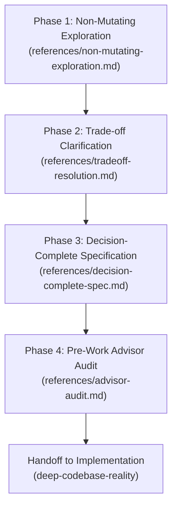

# Decision-Complete Plan

This skill governs technical planning and system design before any code is modified. It prevents shallow planning by requiring complete technical specifications for all schemas, function signatures, error cases, and file sequencing.

## Core Outcomes

- **Decision Completeness:** The resulting plan leaves zero architectural, interface, or design decisions to the implementer.
- **Fact-Grounded Specification:** Every file path, data model, and dependency mentioned in the plan is verified against the actual repository before writing.
- **Non-Mutating Exploration:** System facts are discovered using read-only commands. No tracked files are modified during planning.
- **Critical Files Bounding:** Every plan isolates the exact 3 to 5 files that must be modified and defines their strict execution order.

---

## Planning Workflow

All supporting documentation is stored in the `references/` directory relative to this skill. Read each reference when entering its phase.

---

### Phase 1: Non-Mutating Exploration

Before asking questions or proposing solutions:
1. Read `references/non-mutating-exploration.md`.
2. Inspect the repository to establish factual truth:
   - Identify existing code conventions, similar features, and library dependencies.
   - Trace existing route definitions, controllers, and schemas.
3. Prohibited Actions:
   - Do NOT edit or create tracked files.
   - Do NOT run destructive git commands or file-mutating linters.
   - Do NOT ask the user questions that can be answered by searching the repository.

---

### Phase 2: Trade-off Clarification

Before writing the final specification:
1. Read `references/tradeoff-resolution.md`.
2. Differentiate between two types of unknowns:
   - **Discoverable Facts:** Resolve these by reading files in Phase 1.
   - **Product Preferences and Trade-offs:** If a genuine business decision or breaking change exists, present 2 to 4 structured choices with a recommended default.
3. Lock all assumptions before moving to Phase 3.

---

### Phase 3: Decision-Complete Specification

Before finalizing the plan:
1. Read `references/decision-complete-spec.md`.
2. Draft the implementation plan using the standard decision-complete schema:
   - **Summary:** Concise objective and success criteria.
   - **Interface Contracts:** Exact API routes, request schemas, response schemas, and type definitions.
   - **Error Handling:** Exact exception classes, validation checks, and error responses.
   - **Critical Files and Sequence:** The 3 to 5 critical files listed in their exact modification order.
   - **Testing Criteria:** Concrete unit and integration assertions.

---

### Phase 4: Pre-Work Advisor Audit

Before handing off the plan to implementation:
1. Read `references/advisor-audit.md`.
2. Run an adversarial audit against the proposed plan:
   - Verify that all referenced file paths exist.
   - Verify that proposed imports and libraries are declared in project manifests.
   - Verify that the plan does not introduce unhandled edge cases or broken callers.
3. Output the plan inside a `<proposed_plan>` block.
