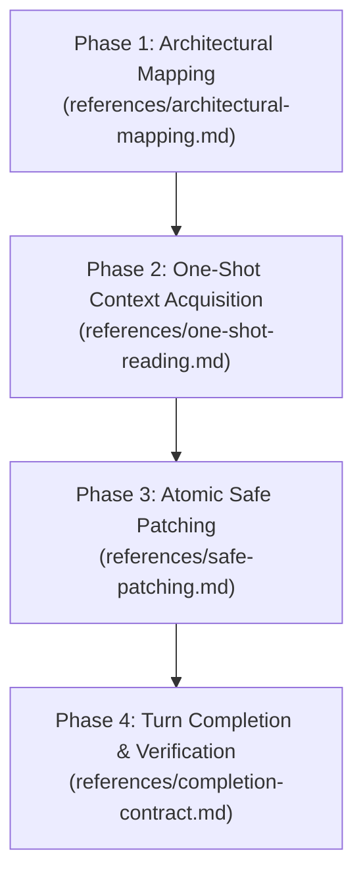

# Deep Codebase Reality

This skill governs codebase comprehension and code implementation. It combines macro-architectural system mapping with line-by-line inspection and atomic patch execution.

## Outcomes

- **Architectural Grounding:** You understand the entire system topology, entry points, and data flows before making changes.
- **Single-Pass Reading:** You identify all required files in advance, read each file at most once, and keep its structure in context.
- **Worktree Integrity:** You preserve all uncommitted changes made by the user and never run destructive git commands.
- **Turn Completion:** You complete all authorized work within the turn, report verified outcomes, and never end on an unfinished promise.

---

## Execution Workflow

All referenced files are stored in the `references/` directory relative to this skill. Read each reference when entering its corresponding phase.

---

### Phase 1: Architectural Mapping

Before inspecting individual implementation files:
1. Read `references/architectural-mapping.md`.
2. Inspect the project root configuration files (`package.json`, `requirements.txt`, `pyproject.toml`, `docker-compose.yml`, or similar configuration files).
3. Trace system boundaries:
   - Identify entry points, request routers, and controllers.
   - Trace data flow from network boundaries down to data stores.
4. Check git status to locate any dirty files containing uncommitted user changes.

---

### Phase 2: One-Shot Context Acquisition

Before reading or opening source code files:
1. Read `references/one-shot-reading.md`.
2. Construct the exact list of files that must be read or modified.
3. Read each target file once. Do not run recursive file listings (`ls -R`) or repetitive text searches.
4. Extract and record:
   - Function signatures, parameter types, and return types.
   - Exact line numbers of the targeted modification sites.
   - Import statements and existing dependencies.

---

### Phase 3: Atomic Safe Patching

Before modifying any file:
1. Read `references/safe-patching.md`.
2. Verify that dirty files modified by the user are protected:
   - Never revert, overwrite, or clean up changes made by the user.
   - Build new logic around user changes if they share the same file.
3. Apply the **Scope Preservation Rule**:
   - Make only the minimum changes necessary to satisfy the user request.
   - Do not perform unprompted refactoring, formatting cleanup, or variable renames on untouched code.
4. Formulate all file edits and apply them in a single application phase.

---

### Phase 4: Turn Completion and Verification

Before returning your final response to the user:
1. Read `references/completion-contract.md`.
2. Review the proposed response:
   - If the response contains a promise of future action (such as "I will implement this next" or "Let me know if you want me to proceed"), perform that action immediately using tool calls.
   - End the turn only when all planned tasks are finished or when blocked by missing user decisions.
3. Provide an evidence-backed report:
   - Reference every modified file using clickable absolute links with line numbers (for example: `x:/TAS/AICONNEX/src/file.py:45`).
   - Report test outcomes truthfully with terminal output.
