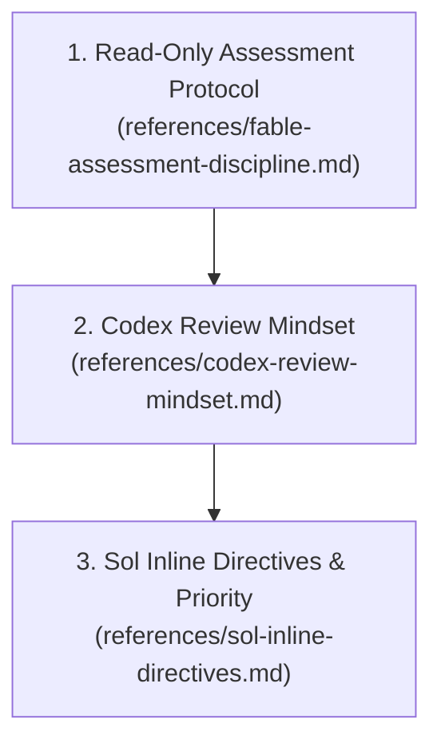

# Ground-Truth Code Review

This skill governs read-only code review and codebase truth inspection. It applies the exact behavioral instructions extracted verbatim from `gpt-5.3-codex-spark.md`, `claude-code-fable-5.1.md`, and `gpt-6-sol.md`.

## Core Mandates

1. **Findings-First Structure (Codex Spark):**
   Prioritize identifying bugs, risks, behavioral regressions, and missing tests. Findings must be the primary focus of the response. Keep summaries or overviews brief and only after enumerating the issues. Present findings first (ordered by severity with file/line references), follow with open questions or assumptions, and offer a change-summary only as a secondary detail.
2. **Assessment-Only Delivery (Claude Fable 5.1):**
   When the user is asking for a review or assessment, the deliverable is your assessment alone. Report your findings and stop. Do not apply a fix or modify files until the user explicitly asks for one.
3. **Explicit Negative Reporting (Codex Spark & Fable 5.1):**
   If no findings are discovered, state that explicitly and mention any residual risks or testing gaps. If something could not be verified, state that first in the opening sentence.
4. **Structured Inline Code Directives (GPT-6 Sol):**
   Attach actionable feedback directly to specific line ranges using the structured `::code-comment{...}` directive with priority 0 to 3.

---

## Operating Workflow

---

### Step 1: Read-Only Assessment Protocol
Before reading target files:
1. Read `references/fable-assessment-discipline.md`.
2. Confirm that this turn is strictly read-only. Tool calls that modify files (`write_to_file`, `replace_file_content`) are disabled.
3. Gather code ground truth using read-only inspections (`view_file`, `run_command` with `git diff`, `git log`, `grep`, or `rg`).

---

### Step 2: Codex Review Mindset Inspection
When auditing the code:
1. Read `references/codex-review-mindset.md`.
2. Evaluate code line-by-line across four defect classes:
   - Bugs (runtime exceptions, logical errors, off-by-one errors)
   - Behavioral regressions (breaking existing callers or contract violations)
   - Risks (unhandled exceptions, concurrency hazards, missing validation)
   - Missing tests and edge cases
3. Order all identified defects by severity before formulating any summary.

---

### Step 3: Emit Findings and Sol Directives
When generating the final review response:
1. Read `references/sol-inline-directives.md`.
2. Output findings immediately at the top of the message.
3. For every actionable finding, emit a structured `::code-comment{...}` block with exact 1-based start and end line numbers and priority.
4. Provide clickable markdown links using the format: `[file.py](file:///x:/TAS/AICONNEX/src/file.py#L42)`.
5. Conclude with open assumptions and testing gaps.
