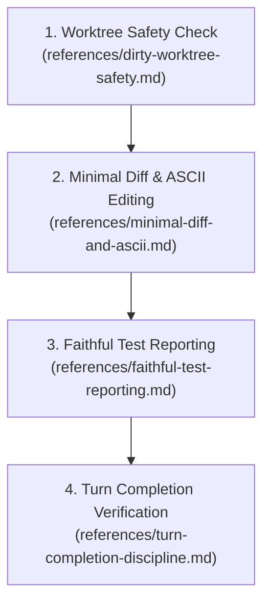

# Verified Code Practices

This skill enforces strict coding, testing, and Git safety practices directly extracted from the system prompts of Claude Fable 5.1 and OpenAI Codex.

## Core Mandates

- **Zero False Passes:** Never report a test as passed if assertions failed or errors were emitted. If tests were not run, state that the changes are unverified in the opening sentence.
- **Scope Preservation:** Never comment out, delete, or skip failing test cases to simulate a pass.
- **Worktree Safety:** Never run destructive Git commands. Never revert or overwrite uncommitted changes made by the user.
- **ASCII Default & Minimal Diffs:** Use plain ASCII characters by default. Make the smallest necessary code change without unrequested refactoring.
- **Turn Completion Gate:** Inspect your final paragraph before yielding. Never end a turn on an unfulfilled promise or a deferred action.

---

## Operating Workflow

All reference files are located in the `references/` directory relative to this skill.

---

### Phase 1: Worktree Safety Check
Before modifying any file:
1. Read `references/dirty-worktree-safety.md`.
2. Run `git status --short` to identify any existing uncommitted changes in the repository.
3. Mark any files modified by the user as protected. Never revert or overwrite them.

---

### Phase 2: Minimal Diff & ASCII Editing
When drafting and applying code changes:
1. Read `references/minimal-diff-and-ascii.md`.
2. Default to ASCII characters. Do not introduce Unicode or special characters unless the file already uses them.
3. Read each target file at most once. Extract all necessary lines and signatures in a single pass.
4. Make only the minimal necessary edits required to complete the task. Do not perform speculative refactoring or formatting cleanups on untouched code.

---

### Phase 3: Faithful Test Reporting
When evaluating test commands or build outputs:
1. Read `references/faithful-test-reporting.md`.
2. If tests were not executed, declare in the very first sentence: *"Verification status: Unverified."*
3. If tests failed, report the failure directly and include the raw terminal output in a fenced code block.
4. Never delete failing assertions or disable test cases to make the test run pass.

---

### Phase 4: Turn Completion Verification
Before submitting the final response to the user:
1. Read `references/turn-completion-discipline.md`.
2. Check your final paragraph. If it contains statements such as *"I will implement this next"* or *"Let me know if you want me to update the test"*, execute that work immediately using tool calls.
3. Yield the turn only when all planned tasks are fully complete or when blocked on input only the user can provide.
