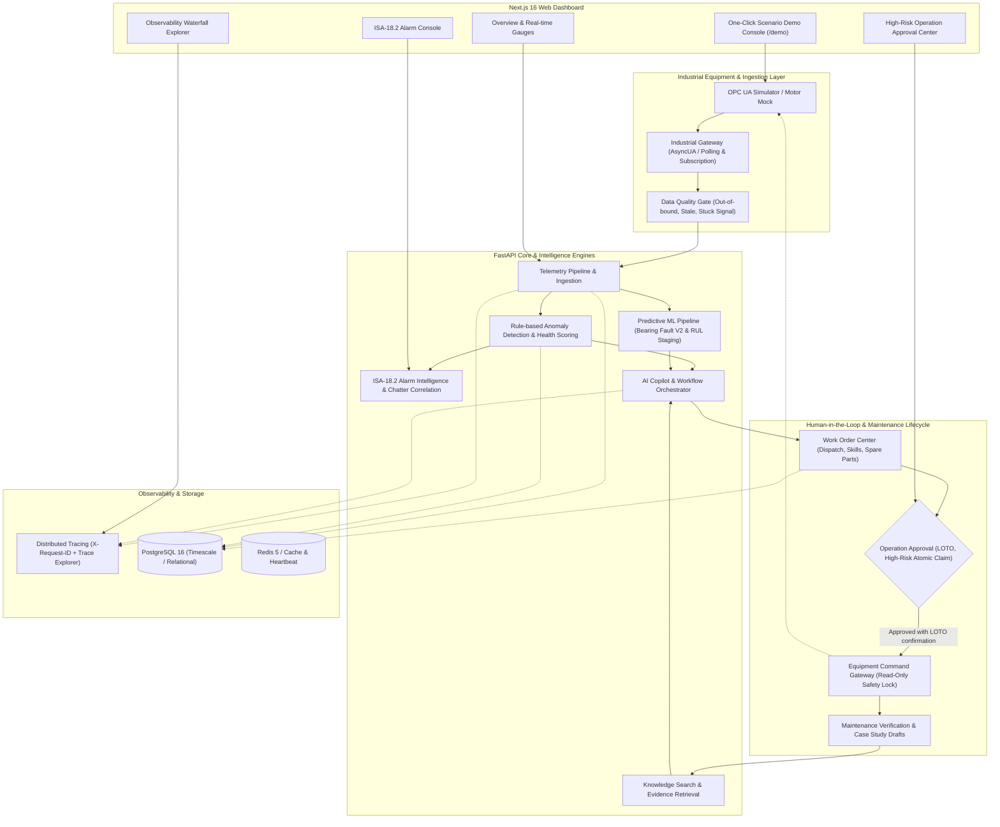

# Architecture

> Generated by /codebase-mapper and /graphify on 2026-10-12

## Overview

The **Industrial Maintenance Copilot** (基于 AI Agent 的工业设备智能运维与预测性维护平台) is an end-to-end, enterprise-grade industrial predictive maintenance platform. It integrates simulated OPC UA equipment ingestion, data quality screening, deterministic operational rule engines, bearing fault ML classification, evidence-bound RAG diagnostics, human-in-the-loop (HITL) approval gates, and complete work order lifecycles with distributed OpenTelemetry tracing.

The system is architected as a polyglot monorepo featuring a **FastAPI (Python 3.11)** backend and a **Next.js 16 (React 19 / TypeScript / Tailwind CSS)** frontend, backed by **PostgreSQL 16** and **Redis**.

---

## System Diagram

---

## Components

### 1. Industrial Gateway (`apps/api/app/industrial_gateway`)
- **Purpose:** Ingests raw telemetry from OPC UA servers via both periodic polling (`sync_once`) and event-driven subscription client (`AsyncuaSubscriptionClient`). Provides data quality validation (`quality.py`) to catch stuck sensors, stale timestamps, and physical threshold violations before data reaches AI algorithms.
- **Location:** `apps/api/app/industrial_gateway/`
- **Dependencies:** `asyncua`, `sqlalchemy`, `pydantic`, `app.core.config`, `app.core.trace`
- **Dependents:** `apps/api/app/api/v1/endpoints/gateway.py`, `apps/api/app/services/intelligence_service.py`

### 2. Operational Health & Anomaly Rule Engine (`apps/api/app/services/intelligence_service.py`)
- **Purpose:** Computes deterministic equipment health scores (0-100), detects domain anomalies (bearing wear, overheating, vibration spikes, motor overload, sensor failure) based on industrial baseline rules without depending on external proprietary LLMs.
- **Location:** `apps/api/app/services/intelligence_service.py`
- **Dependencies:** `apps/api/app/models/`, `apps/api/app/schemas/intelligence.py`
- **Dependents:** `apps/api/app/api/v1/endpoints/intelligence.py`, `apps/api/app/api/v1/endpoints/demo.py`

### 3. Predictive Machine Learning Engine (`apps/api/app/ml`)
- **Purpose:** Extracts time-domain and frequency-domain vibration features from accelerometer datasets (Paderborn, XJTU-SY). Runs Fault Classification V2 and RUL research models under strict staging promotion gates (OOD and cross-bearing validation).
- **Location:** `apps/api/app/ml/`
- **Dependencies:** `numpy`, `scipy`, `scikit-learn`, `joblib`
- **Dependents:** `apps/api/app/api/v1/endpoints/ml.py`, `apps/api/app/services/intelligence_service.py`

### 4. Evidence-Bound AI Copilot & Knowledge Retrieval (`apps/api/app/ai`)
- **Purpose:** Combines lexical/metadata-weighted RAG (`knowledge_search.py`) against published equipment manuals, SOPs, and past maintenance cases. Generates root-cause analysis (RCA) hypotheses and recommendations. Enforces human review flag when confidence < 0.8.
- **Location:** `apps/api/app/ai/`
- **Dependencies:** `httpx`, `app.core.config`, `app.models.knowledge`
- **Dependents:** `apps/api/app/api/v1/endpoints/copilot.py`, `apps/api/app/services/intelligence_service.py`

### 5. Human-in-the-Loop Safety & Approval Service (`apps/api/app/services/approval_service.py`)
- **Purpose:** Protects industrial safety by enforcing that high-risk equipment commands (e.g., shutdown, speed adjustment) CANNOT be executed directly by AI agents or API callers. Requires supervisor/admin approval with LOTO (Lockout/Tagout) confirmation; uses atomic database claims to prevent race conditions.
- **Location:** `apps/api/app/services/approval_service.py`
- **Dependencies:** `apps/api/app/gateways/equipment.py`, `apps/api/app/models/intelligence.py`
- **Dependents:** `apps/api/app/api/v1/endpoints/intelligence.py`

### 6. Work Order & Maintenance Lifecycle Service (`apps/api/app/services/workorder_service.py`)
- **Purpose:** Orchestrates the full lifecycle of work orders (Draft -> Created -> Assigned -> In Progress -> Pending Verification -> Completed/Cancelled), technician dispatch by skill matching, and spare parts inventory reservations.
- **Location:** `apps/api/app/services/workorder_service.py`
- **Dependencies:** `apps/api/app/models/workorder.py`, `apps/api/app/models/equipment.py`
- **Dependents:** `apps/api/app/api/v1/endpoints/work_orders.py`

### 7. Observability & Distributed Tracing (`apps/api/app/core/trace.py` & `apps/api/app/services/observability_service.py`)
- **Purpose:** Tracks end-to-end execution across ingestion, anomaly detection, AI diagnosis, approval, and execution using OpenTelemetry-compatible traces and HTTP request correlation (`X-Request-ID`).
- **Location:** `apps/api/app/core/trace.py`, `apps/api/app/services/observability_service.py`
- **Dependencies:** `opentelemetry-api`, `opentelemetry-sdk`, `prometheus-client`
- **Dependents:** `apps/api/app/main.py`, `apps/api/app/api/v1/endpoints/observability.py`

### 8. Web Frontend Console (`apps/web/src`)
- **Purpose:** Single-page Next.js 16 application providing operator and supervisor dashboards, real-time gauges, ISA-18.2 alarm console, trace waterfall viewer, interactive scenario demo console (`/demo`), and work order dispatching.
- **Location:** `apps/web/src/`
- **Dependencies:** `next 16.3`, `react 19`, `@tanstack/react-query`, `lucide-react`, `recharts`, `tailwindcss`
- **Dependents:** End users and operators

---

## Data Flow

### 1. Ingestion & Quality Gate Flow
1. Software motor simulator or field OPC UA server publishes telemetry (Vibration RMS, bearing temperature, motor current, voltage, rpm, load ratio, ambient temperature, cumulative hours).
2. `OpcUaGatewayService` samples values via polling (`sync_once`) or subscription buffer.
3. `DataQualityGate` inspects telemetry: checks timestamps, boundary constraints, and sensor disconnection flags.
4. Accepted snapshots are persisted as `TelemetryRecord` with an active `trace_id`.

### 2. Diagnosis & Automated Maintenance Workflow
1. `intelligence_service` runs deterministic anomaly rule detection and updates the equipment health score.
2. If anomalies exist, the `ml` model predicts fault classifications (bearing inner race, outer race, cage, roller wear).
3. The RAG subsystem retrieves matched SOPs and verified maintenance cases for the diagnosed fault.
4. If risk level is High or Critical, the system automatically drafts a `WorkOrder`, matches technicians by skill, and reserves spare parts.
5. If the remediation strategy requires physical interventions (e.g., motor emergency shutdown), an `OperationApproval` record is created in `pending` state.

### 3. Human-in-the-Loop Approval & Command Execution
1. Supervisor logs into `/approvals` or `/demo` review panel.
2. Supervisor inspects the RCA evidence, confirms maintenance window and LOTO safety requirements, and submits approval.
3. `approval_service` atomically claims the record (`executing`), validates idempotency key, and dispatches the command to `EquipmentGateway`.
4. Execution results and audit trails are recorded; once completed, post-maintenance telemetry is validated (`create_verification`).

---

## Integration Points

| External Service / Boundary | Interface Type | Purpose | Fallback / Production State |
|-----------------------------|----------------|---------|-----------------------------|
| **OPC UA Server** | TCP Binary / OPC UA (`asyncua`) | Real-time industrial telemetry & commands | Software mock simulator (`MockOpcUaClient`) with deterministic seed |
| **LLM Provider** | REST API (OpenAI-compatible) | Copilot conversational RCA & explanations | Mock AI fallback (`MockLLMProvider`) when keys are absent |
| **Relational Database** | PostgreSQL 16 (psycopg3) | Relational records, telemetry history, audit | SQLite fallback for local test suites |
| **Cache & Heartbeat** | Redis 5.2+ | Gateway event buffers, rate limits, heartbeat | In-memory fallback if Redis is unconfigured |
| **Prometheus / OTel Collector** | HTTP / OTLP | Prometheus metrics scraping (`/metrics`) and trace exporting | In-memory span recording and query via `/observability/traces` |
| **Notification Gateway** | Internal Facade | System notifications for alarms and approvals | In-app DB notification; ready for Email/SMS/Webhook adapter |

---

## Conventions

- **Naming Conventions:**
  - Python: PEP 8 compliant, snake_case for functions/methods, PascalCase for classes, UPPER_CASE for constants.
  - TypeScript: PascalCase for React components and types, camelCase for variables/functions.
- **Architecture Pattern:**
  - Layered Architecture: API Endpoint (`apps/api/app/api/v1/endpoints`) -> Service Layer (`apps/api/app/services`) -> Model/DAO Layer (`apps/api/app/models`) -> External Gateway Boundary (`apps/api/app/gateways`).
- **Traceability:**
  - Every business operation carries a `trace_id` propagated through ContextVars and recorded in database tables (`agent_runs`, `tool_invocations`, `telemetry_records`).
- **Safety First:**
  - Hardware execution commands are strictly read-only by default and require supervisor database atomic approval.
- **Testing:**
  - Pytest with `pytest-asyncio` for unit, integration, and gateway tests (`apps/api/tests/`).
  - Jest + React Testing Library for frontend component unit tests (`apps/web/src/__tests__/`).
  - Playwright for end-to-end browser user flows (`apps/web/e2e/`).

---

## Technical Debt & Current Status

- [ ] **Real Field Hardware Ingestion:** Field PLC / SCADA integration is validated via simulated OPC UA; field deployment to physical plant network has not been performed.
- [ ] **ML RUL Model Promotion:** Remaining Useful Life (RUL) research on XJTU-SY did not pass the rigorous cross-domain promotion gate, so it remains in research status and is not promoted to production staging.
- [ ] **Fault Model V2 Staging:** Fault classification V2 is verified on Paderborn dataset but labeled as non-production research staging.
- [ ] **Notification Gateway:** Currently logs to the in-app database notifications table; enterprise webhook/SMS/Teams adapters are defined as architectural extension points.
