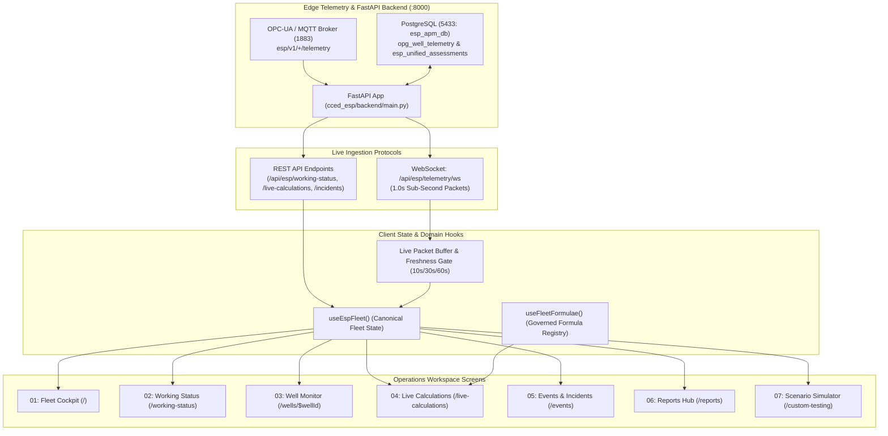

# 🧭 Operations Workspace Route Specification Index

**Application:** ADVAIT ESP-PMM (Asset Performance Monitoring & Management)  
**Workspace:** `Operations` (`WORKSPACES.operations`)  
**Target Architecture:** Multi-Tier SCADA Telemetry, Thermodynamic VFM, ML Fault Spectrum & Event Forensics  
**Documentation Root:** [`x:\TAS\v2_ESP\route-specification-docs\`](file:///x:/TAS/v2_ESP/route-specification-docs)  

***

## 1. Operations Workspace Overview

The **Operations Workspace** is the real-time operational command center of the ADVAIT ESP-PMM platform. It is engineered for surveillance engineers, production technologists, and control room operators monitoring the 10 active electrical submersible pump (ESP) digital twin assets across Gathering Centers `GCS-03`, `GCS-04`, and `GCS-15` in Block 3 / Block 4.

### Operations Navigation Hierarchy (`AppShell.tsx:55-61`)

| Order | Route Path | Navigation Label | Core Functional Focus | Specification Document |
|:---:|---|---|---|---|
| **01** | `/` | **Fleet Cockpit** | Centralized fleet surveillance, KPI cards, multi-discipline FleetTable, top-10 attention queue. | [`01_route_root_cockpit.md`](file:///x:/TAS/v2_ESP/route-specification-docs/01_route_root_cockpit.md) |
| **02** | `/working-status` | **Well Working Status** | Live ML 14-fault classifier spectrum, deterministic SCADA envelopes, physics checks, master-detail queue. | [`02_route_working_status.md`](file:///x:/TAS/v2_ESP/route-specification-docs/02_route_working_status.md) |
| **03** | `/wells/$wellId` | **Well Monitor (Detail)** | Single-well surveillance: 2D ESP string visualizer, live H-Q curve, 4-subsystem equalizer, 2D depth pressure profile. | [`03_route_wells_detail.md`](file:///x:/TAS/v2_ESP/route-specification-docs/03_route_wells_detail.md) |
| **04** | `/live-calculations` | **Live Calculations** | 10-well real-time derived parameters, Virtual Flow Metering (VFM), higher-order physics & fleet formula editor. | [`04_route_live_calculations.md`](file:///x:/TAS/v2_ESP/route-specification-docs/04_route_live_calculations.md) |
| **05** | `/events` & `/events/$eventId` | **Event Intelligence & Forensics** | Event timeline, active incident lifecycle with live second-counters, trip forensics workspace & SOP actions. | [`05_route_event_intelligence.md`](file:///x:/TAS/v2_ESP/route-specification-docs/05_route_event_intelligence.md) |
| **06** | `/reports` | **Reports Hub** | Governed operational reporting: Telemetry Log Reports, Well Performance deep-dive audits, Advait Excel/CSV engine. | [`06_route_reports_hub.md`](file:///x:/TAS/v2_ESP/route-specification-docs/06_route_reports_hub.md) |
| **07** | `/custom-testing` | **Scenario Simulator** | What-if operational scenario simulation, multi-parameter physics sliders, fault injection, and pump curve response. | [`07_route_scenario_simulator.md`](file:///x:/TAS/v2_ESP/route-specification-docs/07_route_scenario_simulator.md) |

***

## 2. Shared Data Architecture & Protocols Across Operations

### Core Design Principles
1. **Zero Fabrication Policy (Rule 1 & Rule 2):** Missing or disconnected data is explicitly flagged with `STALE`, `NO_DATA`, or `UNREACHABLE` badges. The system never injects synthetic numbers to mask a dead server.
2. **Decoupled Telemetry vs. Inferred Assessments:** Raw physical sensor readings (Freq, Amps, Volts, PIP, PDP, Temp, Vib) update at **1.0 Hz** via WebSockets without waiting for 10-second ML model inferences, eliminating UI lag and chart flickering.
3. **Identity Normalization:** Unified `normalizeWellId()` ensures legacy well string variants (`FS-04`, `FS-004`, `ASSET-FS-004`) resolve to identical digital twin representations across all routes.
