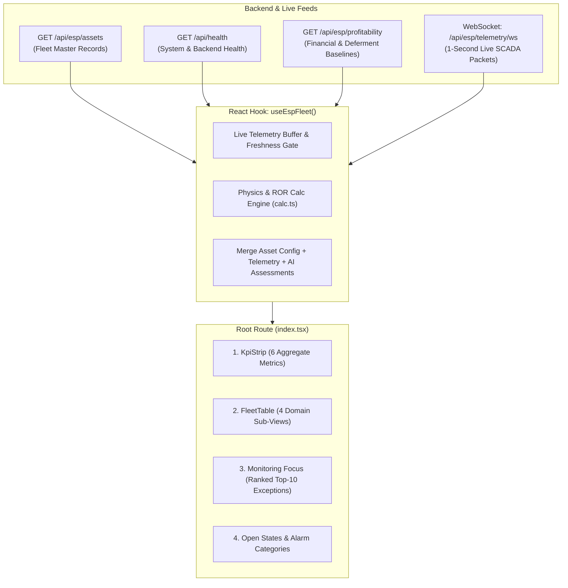

# 🧭 Route Specification: `/` — ESP Fleet Cockpit
**Application Workspace:** ESP Insight Suite (Advait ESP-PMM)  
**File Location:** [`src/routes/index.tsx`](file:///x:/TAS/v2_ESP/esp-insight-suite/src/routes/index.tsx)  
**Sub-Components:** [`src/components/esp/FleetTable.tsx`](file:///x:/TAS/v2_ESP/esp-insight-suite/src/components/esp/FleetTable.tsx), [`src/components/esp/EspWellVisual.tsx`](file:///x:/TAS/v2_ESP/esp-insight-suite/src/components/esp/EspWellVisual.tsx), [`src/components/esp/ui.tsx`](file:///x:/TAS/v2_ESP/esp-insight-suite/src/components/esp/ui.tsx)  
**Core Data Hook:** [`src/hooks/useEspFleet.ts`](file:///x:/TAS/v2_ESP/esp-insight-suite/src/hooks/useEspFleet.ts)  

***

## 1. Route Metadata & Header

### Route Definition
* **Route Path:** `/` (Index / Root Landing Page)
* **Page Title:** `ESP Fleet Cockpit — ADVAIT ESP-PMM`
* **OpenGraph / Meta Description:**
  > *"Centralised ESP fleet surveillance: health index, availability, production deferment, and ranked attention queue across live field assets."*

### Header Section (`PageHeader`)
* **Title:** `ESP Fleet Cockpit`
* **Purpose:** The primary operational control room and tactical entry point for electrical submersible pump (ESP) operations across CCED Block 3 / Block 4 fields.
* **Integrity / System Alert Banners:**
  1. **Backend Unreachable Alert (Critical):** Renders when `hasNoData && isError`. Alerts operators that no data has been received from FastAPI (`:8000`) and displays zero fabricated placeholders.
  2. **Data Stale / Dropout Warning (Warning):** Renders when `s.staleCount > 0 || s.noDataCount > 0`. Shows the exact count of wells whose telemetry timestamp exceeds `LIVE_HOLD_S` thresholds (e.g. `2 of 10 wells not reporting live data: 2 stale (last known values shown)`).

***

## 2. Component 1: Top KPI Strip (`KpiStrip`)

Located immediately beneath the page header. Displays **6 fleet-wide operational composite metrics** aggregated across all reporting assets in real time:

| # | KPI Label | Display Value | Unit | Subtitle / Context | Tone / Color Coding | Engineering Calculation & Data Source |
|---|---|---|---|---|---|---|
| **1** | **Wells running** | `${s.running}/${s.total}` | — | `${s.down} down` | `normal` (Emerald) | `running` count = wells with $\text{Hz} > 0$ and state $\neq$ `vsd-trip` / `stopped-unplanned`. `total` = active fleet count (10 wells). |
| **2** | **Availability** | `s.availability` | `%` | `Run status weighted, 24 h` | Default | Availability percentage calculated over a rolling 24-hour run window: $\frac{\text{Active Uptime Hours}}{\text{Total Available Fleet Hours}} \times 100$. |
| **3** | **Fleet ESP health index** | `s.health` | `/100` | `Weighted envelope + thermal + degradation` | `watch` (Amber) | Composite fleet average health index derived from physics envelope compliance, motor winding temperature headroom, vibration severity, and ML degradation scores. |
| **4** | **Oil rate** | `n0(s.oil)` | `bopd` | `Allocated, latest scan` | Default | Total allocated net oil rate: $\sum \text{oilRateBopd}$ across all producing wells formatted with thousand separators. |
| **5** | **Production deferment** | `n0(s.deferred)` | `bopd` | `Vs expected from active cases` | `warning` (Orange) | Net deferred production: $\sum (\text{Target Potential Rate} - \text{Actual Produced Rate})$ for restricted, tripped, or throttled wells. |
| **6** | **Deferred value at risk** | `usd(s.valueUsdDay)` | `/day` | `Offline & choked capacity` | `warning` (Orange) | Monetized daily financial revenue loss: $\text{Total Deferred BOPD} \times \text{Current Realized Oil Price USD/bbl}$. |

***

## 3. Component 2: Fleet Monitor (`FleetTable`)

A full-width surveillance grid providing comprehensive fleet visibility across multiple operational disciplines.

### A. Controls & Filter Bar
Above the table, operators have interactive filters and sub-view controls:
1. **Search Input (`q`):** Real-time text filter matching well ID (`FS-004`), gathering station (`GCS-03`), or pump model family (`TE2700`).
2. **Station Dropdown (`station`):** `All stations`, `GCS-3`, `GCS-4`, `GCS-15`.
3. **Field Dropdown (`field`):** `All fields`, `Farha South [FS]`, `Farha North West [FNW]`, `Farha West South [FWS]`.
4. **State Filter Dropdown (`stateFilter`):**
   * `All states`
   * `Normal` (State is normal, $\text{health} \ge 70$, $\text{Hz} > 0$)
   * `Tripped / Stopped` ($\text{Hz} = 0$, VSD trip, planned/unplanned stop)
   * `Anomalies / Degraded` (Running with active fault or $\text{health} < 70$)
5. **Sub-View Switcher (`subView` Tabs):** Four specialized domain views:
   * **`Operations`** *(Default)*
   * **`Production & VFM`**
   * **`Equipment & Run Life`**
   * **`OPC Telemetry`**
6. **Fleet Count Indicator:** Displays filtered well count (e.g. `10 wells`).

***

### B. Sub-View 1: `Operations` (Tactical Control Room View)
Focuses on current operating stability, operating envelopes, and anomalies:

| Column Header | Field Key | Width (px) | Sortable | Description & Logic |
|---|---|---|:---:|---|
| **Well** | `id` | 130 | Yes | Well identifier (`FS-004`) with running status glyph (`EspStatusGlyph`: Green pulsing = Running, Red = Tripped, Amber = Anomaly) and `ProvenanceBadge` (LIVE, STALE, CACHE). Clicking opens `/wells/$wellId`. |
| **Station / Cluster** | `station` | 160 | Yes | Gathering station badge (`GCS-03`, `GCS-04`, `GCS-15`) and field block code (`Farha South [FS]`). |
| **Operating State** | `state` | 130 | Yes | Status badge: `Normal`, `Outside ROR — low flow`, `Gas interference`, `Pump wear`, `Motor overload`, `VSD trip`, `Stopped — unplanned`. |
| **ROR Envelope** | `envelope` | 120 | Yes | Recommended Operating Range status: `Inside ROR` (Green), `Downthrust` (Amber, $Q < \text{ROR}_{\min} \times \frac{f}{f_0}$), `Upthrust` (Amber, $Q > \text{ROR}_{\max} \times \frac{f}{f_0}$), `Off / Zero Flow` (Red). |
| **Health** | `health` | 80 | Yes | Numerical Health Index (`0–100/100`) color-banded: Green ($\ge 75$), Amber ($50–74$), Red ($< 50$). |
| **Diagnosis / Anomaly** | `diagnosis` | 160 | No | Headline engineering verdict or classified fault mode (e.g. `Downthrust Exposure (Choked Choke / Low Inflow)` or `Nominal Steady-State`). |
| **Deferment** | `deferment` | 100 | Yes | Lost production in BOPD (e.g. `+140 BOPD` in Red if restricted, `0 BOPD` if operating at potential). |

***

### C. Sub-View 2: `Production & VFM` (Virtual Flow Metering)
Focuses on reservoir delivery, fluid cuts, and pump flow rates:

| Column Header | Field Key | Description & Engineering Logic |
|---|---|---|
| **Well** | `id` | Well identifier link with live status glyph. |
| **Station / Cluster** | `station` | Gathering station assignment (`GCS-03`, `GCS-04`, `GCS-15`). |
| **Gross Liquid** | `liquid` | Total fluid rate in `BPD` (Barrels per day) estimated via Virtual Flow Meter or surface test separator. |
| **Net Oil** | `oil` | Allocated net dry crude production rate in `BOPD`. |
| **Water Cut** | `waterCut` | Produced water percentage (`0.0% – 100.0%`). High water cut increases fluid density and motor load. |
| **BEP %** | `bep` | Best Efficiency Point percentage: $\frac{Q_{\text{actual}}}{\text{BEP}_{\text{rated}} \times (f / 60)} \times 100$. Shows Green if within $\pm 10\%$ of BEP ($90\%–110\%$), Amber if off-design. |
| **Deferment** | `deferment` | Production loss versus design baseline (`BOPD`). |

***

### D. Sub-View 3: `Equipment & Run Life` (Asset Reliability)
Focuses on hardware specifications and mechanical aging:

| Column Header | Field Key | Description & Engineering Logic |
|---|---|---|
| **Well** | `id` | Well identifier link. |
| **Station / Cluster** | `station` | Gathering station assignment. |
| **Pump Model** | `pumpModel` | Downhole centrifugal pump family/model (e.g. `TE2700`, `P-100`, `B-400`). |
| **Stages** | `stages` | Total number of installed pump stages (impellers + diffusers, e.g. `110 stg`, `180 stg`). |
| **Motor HP** | `motorHp` | Nameplate electrical motor power rating in `HP` (e.g. `120 HP`, `240 HP`). |
| **VSD Model** | `vsdModel` | Surface Variable Speed Drive converter specification (e.g. `VFD-480V`, `ACS880`). |
| **Days on Run** | `runLife` | Continuous days since downhole commissioning (`runLifeDays`). Flagged Amber if $> 1{,}000\text{ days}$. |
| **Install Date** | `installDate` | Historical downhole completion/workover installation date (`YYYY-MM-DD`). |

***

### E. Sub-View 4: `OPC Telemetry` (Raw SCADA Multi-Channel Stream)
Wide-table high-density view displaying **14 physical telemetry sensors** ingested from edge SCADA/OPC-UA:

| Sensor Header | Column Key | Engineering Unit | Safe Thresholds & Nominal Range |
|---|---|:---:|---|
| **Freq (Hz)** | `freq` | `Hz` | VFD operating speed ($30.0–65.0\text{ Hz}$). $0.0\text{ Hz}$ when stopped. |
| **Amps (A)** | `amps` | `A` | Motor drive 3-phase current draw. |
| **Volts (V)** | `volts` | `V` | Downhole motor terminal voltage ($380–480\text{ V}$). |
| **PIP (PSI)** | `pip` | `psi` | Pump Intake Pressure. Critical indicator of reservoir pressure and pump-off. |
| **PDP (PSI)** | `pdp` | `psi` | Pump Discharge Pressure. Measure of fluid column lift and wellhead delivery. |
| **Motor Temp (°C)** | `motorTemp` | `°C` | Downhole motor winding temperature. Flagged Critical if $> 120^\circ\text{C}$. |
| **Intake Temp (°C)** | `intakeTemp` | `°C` | Downhole fluid intake temperature. |
| **Vibration (g)** | `vibration` | `g` | Mechanical acceleration/vibration. Flagged Critical if $> 1.2\text{ g}$. |
| **WHP (PSI)** | `whp` | `psi` | Wellhead Tubing Pressure. |
| **FLP (PSI)** | `flp` | `psi` | Flowline Pressure downstream of the choke. |
| **Annulus (PSI)** | `annulus` | `psi` | Casing-tubing annulus gas pressure. |
| **Leak Cur (ct)** | `leak` | `ct` | Cable electrical insulation leakage count / ground fault sensor. |
| **DHG Cur (mA)** | `dhg` | `mA` | Downhole gauge telemetry loop current ($4–20\text{ mA}$). |
| **STD_VFD_STS** | `vfdSts` | binary | VFD run status contact ($1 = \text{Run}$, $0 = \text{Stop}$). |

*Note: In `OPC Telemetry` mode, the **Well ID** column is pinned (`sticky left-0`), and all column headers support custom drag-resizing with settings saved directly to browser `localStorage`.*

***

## 4. Component 3: Monitoring Focus (`Operational Surveillance Queue`)

Located below the Fleet Monitor. An automated exception ranking engine sorting problematic wells.

* **Section Header Action:** `Open Working Status →` (navigates to `/working-status`).
* **Sorting Rule:** Ranked primarily by **Severity** (`critical` $\rightarrow$ `warning` $\rightarrow$ `watch`), then secondary-ranked by **Production Impact (BOPD)**.
* **Max Rows Displayed:** Top 10 critical operational exceptions (`needsAttention.slice(0, 10)`).

### Table Columns
1. **Severity:** Status pill displaying `critical` (Red), `warning` (Orange), or `watch` (Amber).
2. **Well:** Clickable link navigating directly to [`/wells/$wellId`](file:///x:/TAS/v2_ESP/esp-insight-suite/src/routes/wells.$wellId.tsx).
3. **ML Status (Healthy / Anomaly):** Automated AI diagnosis badge (`Anomaly (Outside ROR)`, `Anomaly (Gas Locking)`, `Anomaly (Motor Overload)`).
4. **Operating Regime / Fault Mode:** Specific diagnosed physical condition or root-cause category.
5. **Impact bopd:** Quantity of oil deferred or threatened by this specific condition.
6. **Age:** Elapsed duration since the exception condition was first triggered (formatted via `hoursToDuration(durationH)`, e.g. `4h 15m`).
7. **Conf.:** AI/ML classification statistical confidence percentage (e.g. `94%`, `99%`).

***

## 5. Component 4: Open States, Alerts and Alarms Category List

Located at the bottom of the cockpit. Renders a distribution grid visualizing how the active fleet is partitioned across operating states and fault modes.

* **Grid Layout:** Responsive cards (`sm:grid-cols-2 lg:grid-cols-3 xl:grid-cols-4`).
* **Visual Progress Bars:** Scaled relative to the category with the highest well count (`(count / maxCategoryCount) * 100%`).
* **Category Color Coding:**
  * **Healthy / Normal States:** Emerald green circle + bar (`bg-emerald-500`).
  * **Trip / Overload / Power Loss:** Red circle + bar (`bg-red-500`).
  * **Anomalies / Outside ROR / Warnings:** Amber circle + bar (`bg-amber-500`).
* **Count Badge:** Exact asset count (e.g. `6 wells`, `2 wells`, `1 well`).

***

## 6. Data Source & Network Architecture for `/`

### Key Data Interfaces
* **`useEspFleet()`**: Canonical data orchestrator. Combines REST asset definitions from PostgreSQL with live MQTT/WebSocket SCADA streams.
* **Freshness & Provenance Engine:** Uses `LIVE_FRESH_S` (10s) and `LIVE_HOLD_S` (60s). If a well stops broadcasting MQTT packets, its status transitions from `LIVE` to `STALE`, and finally to `NO_DATA`.
* **Zero Fabrication Policy:** If the backend or database disconnects, the UI displays explicit alert banners rather than synthetic or random mock numbers.
