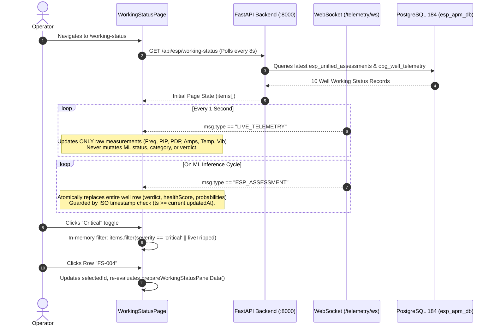

# 🧭 Route Specification: `/working-status` — Well Working Status & Fault Spectrum
**Application Workspace:** ESP Insight Suite (Advait ESP-PMM)  
**File Location:** [`src/routes/working-status.tsx`](file:///x:/TAS/v2_ESP/esp-insight-suite/src/routes/working-status.tsx)  
**Helper Logic:** [`src/lib/workingStatusPanel.ts`](file:///x:/TAS/v2_ESP/esp-insight-suite/src/lib/workingStatusPanel.ts)  
**Backend API SSoT:** [`cced_esp/backend/api/esp_routes.py`](file:///x:/TAS/v2_ESP/cced_esp/backend/api/esp_routes.py) (`GET /api/esp/working-status`)  
**Live Streaming Protocol:** WebSocket (`/api/esp/telemetry/ws` via `telemetryWs.ts`)  

***

## 1. Route Metadata & Header Controls

### Route Definition
* **Route Path:** `/working-status`
* **Page Title:** `Well Working Status — ADVAIT ESP-PMM`
* **OpenGraph / Meta Description:**
  > *"Real-time ESP well working status queue with evidence, fault probabilities, recommended actions and acknowledge / assign / close workflow."*
* **OpenGraph Title:** `ESP Well Working Status & Model Fault Spectrum`
* **OpenGraph Description:** `Live ML Model fault detection and sensor telemetry across the ESP fleet.`

### Header Section (`PageHeader`)
* **Title:** `Well Working Status & Fault Spectrum`
* **Description:** `Real-time ML anomaly detection, 14-fault classification probabilities, and operating status.`
* **Header Actions (`ToggleRow`):** Segmented filter toggle with 5 view options:
  1. **`All`**: Displays the complete fleet (10 simulator active wells).
  2. **`Anomalies`**: Filters for tripped assets (`liveTripped`) or wells deviating from normal baseline (`!isHealthy`).
  3. **`Healthy`**: Filters strictly for un-tripped, nominal baseline assets (`isHealthy && !liveTripped`).
  4. **`Critical`**: Displays immediate-action assets (`severity === "critical"` or `liveTripped`).
  5. **`Warning`**: Displays assets in watch/warning status (`severity === "warning"` and not tripped).

***

## 2. Component 1: Working Status KPI Strip (`KpiStrip`)

Positioned directly under the header. Computes real-time fleet diagnostic distributions:

| # | Metric Label | Display Value | Tone / Color Coding | Subtext | Data Logic |
|---|---|---|---|---|---|
| **1** | **Total Fleet Wells** | `totals.total` | `info` (Blue) | `Active SCADA stream` | Total count of registered reporting wells ($N = 10$). |
| **2** | **Anomalies Detected** | `totals.anomalies` | `critical` (if $> 0$) else `normal` | `Model alerts` | Count of assets where `liveTripped === true` OR `isHealthy === false`. |
| **3** | **Critical Faults** | `totals.critical` | `critical` (Red) | `Immediate action` | Assets with `severity === "critical"` or in tripped state. |
| **4** | **Warning Status** | `totals.warning` | `warning` (Amber) | `Shift inspection` | Assets with `severity === "warning"` operating with non-critical alerts. |
| **5** | **Healthy Operation** | `totals.healthy` | `normal` (Green) | `Normal baseline` | Assets confirmed within calibrated baseline corridors (`isHealthy && !liveTripped`). |

***

## 3. Component 2: Working Status Queue (`Panel` — Master Table)

Located on the left side of the split screen (`xl:grid-cols-[minmax(0,1fr)_minmax(0,1.25fr)]`). Serves as the primary operational selection list.

### Panel Header Elements
* **Title:** `Working Status Queue — {rows.length} wells`
* **Heartbeat Badge:** Pulsing emerald indicator with text `Live 1.0 Hz` signifying active WebSocket telemetry streaming.
* **Scroll Boundary:** Maximum height `calc(100vh - 310px)` with `.panel-scroll` bar.
* **Row Interaction:** Clicking any row selects that well (`setSelectedId(item.id)`), highlighting it with a primary ring/background and populating the right-hand inspection panel.

### Table Column Definitions

| # | Column Header | Alignment | Styling | Description & Display Logic |
|---|---|---|---|---|
| **1** | **Severity** | Left | `<StatusPill>` | Severity badge: `critical` (Red), `warning` (Amber), `watch` (Yellow), `normal` (Green). |
| **2** | **Well ID** | Left | Monospace, Bold | Well tag (`FS-004`, `FS-016`). Displays a `ProvenanceBadge` (`STALE` or `NO_DATA` with age) if packet transmission lags. |
| **3** | **ML Status (Healthy / Anomaly)** | Left | `<StatusPill>` | • If tripped: `TRIPPED` (Red) • If healthy: `Healthy (Normal)` (Green) • If anomaly: `Anomaly ({latchedFault})` (Amber/Red). |
| **4** | **Category / Primary Fault** | Left | Truncated, 190px max | Diagnosed fault signature or operating mode (e.g. `Underload Pump-Off`, `Downthrust Exposure`, `Gas Interference & Lock`, or `Healthy State (Normal Operation)`). |
| **5** | **Freq (Hz)** | Right | Monospace, Font Bold | VSD electrical output frequency. Rendered in **Red** if stopped ($0.0\text{ Hz}$), else **Cyan** (`50.0`, `54.5`). |
| **6** | **Inp (PSI)** | Right | Monospace | Intake Pressure (PIP) in PSI. |
| **7** | **Disch (PSI)** | Right | Monospace | Discharge Pressure (PDP) in PSI. |
| **8** | **Amps (A)** | Right | Monospace | Motor drive current in Amperes. |
| **9** | **Confidence** | Right | Monospace, Bold | Statistical confidence of the classified diagnosis: `(confidence * 100).toFixed(0)%` (e.g. `98%`). |
| **10** | **Health Index** | Right | Monospace, Bold | Overall composite health index (`0–100`): • `< 40`: Red • `40–69`: Amber • `≥ 70`: Emerald. |

***

## 4. Component 3: Selected Well Diagnostic Detail (`Panel` — Detail Inspector)

Positioned on the right side of the split screen. Dynamically updates when an operator clicks any well in the queue.

### A. Inspector Header & Navigation
* **Title:** `{wellId} — {latchedFault || category}`
* **Subtitle:** `ML Scan Verdict: {verdict}`
* **Top Status Badges:**
  * Severity Pill (`critical` / `warning` / `normal`).
  * ML Confidence Pill (`ML Confidence: XX%`).
  * Health Index Pill (`Health Index: XX/100`).
  * Direct Link: `Open Well Monitor →` navigating to [`/wells/$wellId`](file:///x:/TAS/v2_ESP/esp-insight-suite/src/routes/wells.$wellId.tsx).

***

### B. Live Operational Status Banner
Renders one of three distinct diagnostic states:
1. **Critical / Tripped Banner (Red):**
   * Pulsing red ping dot with headline: `ESP PUMP TRIPPED / 0.0 HZ ({category})`.
   * Description explaining drive collapse and zero-frequency condition.
   * Highlighted **Action Advisory** directing operator pre-restart checks.
2. **Anomaly / Warning Banner (Amber):**
   * Pulsing amber ping dot with headline: `ANOMALY DETECTED: {latchedFault}`.
   * Specific diagnostic description and recommended engineering mitigation.
3. **Nominal Banner (Emerald):**
   * Green pulse icon with text: `Machine operating within nominal steady-state corridor`.
   * Stamped timestamp of the latest scan.

***

### C. Sensor KPI Quad
Four quick-read diagnostic tiles:
* **Health Score:** Numerical value out of 100 (colored Red / Amber / Green).
* **Confidence:** Classification certainty percentage.
* **Frequency:** Live operating frequency (`Hz`) in Cyan (or Red if $0.0\text{ Hz}$).
* **Anomaly Drift:** Isolation Forest / autoencoder residual deviation score ($0.00–1.00$). Displays dynamic tags: `Nominal` ($\le 0.15$), `Drifting` ($0.16–0.40$), or `Deviating` ($> 0.40$).

***

### D. Model Prediction Section (`14-Fault Probability Spectrum`)
Displays the probabilistic distribution across the full fault catalog:

* **Header Metadata:** Model version badge (e.g. `fault-classifier-v3.0`), Baseline profile source (e.g. `anchor-FS-004-calibrated`), and calculation age (`Live` or `Xs ago`).
* **Tripped / Inactive Standby Handling:**
  * If a pump is tripped ($0\text{ Hz}$), probability bars are suspended and a specialized alert appears:
    > *"The ML anomaly model is optimized for active flow dynamics. Because this pump is tripped (0 Hz), probability bars are suspended and deterministic SCADA safety envelopes are active below."*
* **Active Probability Bars:**
  * Displays probability bars sorted from highest likelihood to lowest.
  * **Supported AI Classes:** Displays percentage (`%`) and color-coded bars:
    * `> 40%`: Red (Primary suspect).
    * `10% – 40%`: Amber (Secondary indicator).
    * `< 10%`: Emerald / Muted (Low probability).
  * **Untrained / Unmodeled Faults:** Classes without trained inference weights are rendered with an explicit badge: `not modelled` (preventing fake or flat noise numbers).

***

### E. Physics Reservoir Check & Deterministic SCADA Rules
Combines AI classification with hard physical laws:

1. **Physics Reservoir Check (`Activity` Icon):**
   * Evaluates hydrodynamic indicators (e.g. pump-off drawdown score, gas void fraction, solids friction).
   * Displays status badge: `Nominal` (Green) or `Flagged` (Amber).
2. **SCADA Rule-Based Checks (Deterministic Protection):**
   * Displays count of triggered rules (e.g. `0 Triggered` vs `3 Triggered`).
   * If nominal: Green checkmark with text `All SCADA envelope thresholds within normal operating limits.`
   * If triggered: Renders individual classified cards:
     * **Critical Envelope Breach (`AlertTriangle`, Red):** Emergency shut-off or high trip threshold.
     * **Out of Operating Limits (`Gauge`, Amber):** PIP below bubble point, severe downthrust flow.
     * **Electrical Trip / Fault (`Zap`, Sky Blue):** Phase imbalance, voltage collapse, underload current.

***

## 5. Component 4: Open States, Alerts and Alarms Category List

Located across the bottom of the page (`Panel`):

* **Title:** `Open States, Alerts and Alarms Category List`
* **Subtitle:** `Live distribution of fleet operating states, fault types (leaving healthy state), alerts, alarms and healthy wells from SCADA & ML Model`
* **Visual Progress Grid:**
  * Responsive 4-column card grid (`sm:grid-cols-2 lg:grid-cols-3 xl:grid-cols-4`).
  * Aggregates the 10 wells into discrete operating categories (e.g. `Healthy State`, `Underload Pump-Off`, `Outside ROR`, `Gas Interference`).
  * Displays well count (`X wells`) and a proportional progress bar colored according to category type:
    * `Healthy / Normal`: Emerald green (`bg-emerald-500`).
    * `Trip / Overload / Power Loss`: Red (`bg-red-500`).
    * `Anomalies / Warnings`: Amber (`bg-amber-500`).

***

## 6. Data Architecture, Synchronization & Reactivity

### State Synchronization Safeguards
1. **Separation of Telemetry vs. Assessments:**
   * Raw high-frequency sensor updates (`LIVE_TELEMETRY`) update only measurement numbers. They cannot accidentally overwrite or flicker the AI verdict or health scores.
2. **Timestamp Guard (`newTs >= currTs`):**
   * If an older REST polling response arrives after a newer WebSocket event, it is automatically discarded, preventing state regression.
3. **No Zero-Bar Fabrication:**
   * If model inference is delayed or stopped, the UI explicitly flags `Prediction Status: Standby / Tripped` rather than fabricating zero or random probability bars.
