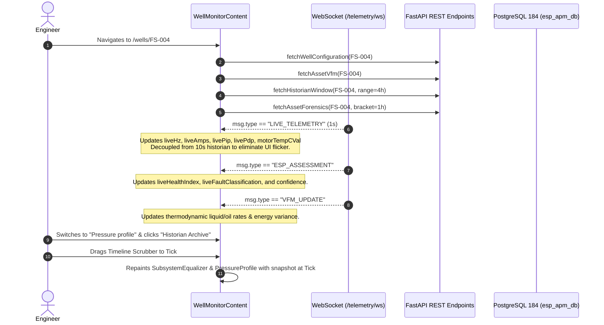

# 🧭 Route Specification: `/wells` & `/wells/$wellId` — ESP Well Detail & Surveillance Monitor
**Application Workspace:** ESP Insight Suite (Advait ESP-PMM)  
**File Locations:**  
- Index Route (Redirect): [`src/routes/wells.index.tsx`](file:///x:/TAS/v2_ESP/esp-insight-suite/src/routes/wells.index.tsx)  
- Detail Route (Monitor): [`src/routes/wells.$wellId.tsx`](file:///x:/TAS/v2_ESP/esp-insight-suite/src/routes/wells.$wellId.tsx)  
**Core Sub-Components:**  
- Live Pump Performance Curve: [`src/components/esp/LivePumpPerformanceCurve.tsx`](file:///x:/TAS/v2_ESP/esp-insight-suite/src/components/esp/LivePumpPerformanceCurve.tsx)  
- ESP 2D String Visualizer: [`src/components/esp/EspWellVisual.tsx`](file:///x:/TAS/v2_ESP/esp-insight-suite/src/components/esp/EspWellVisual.tsx)  
- 4-Subsystem Equalizer: [`src/components/esp/SubsystemEqualizer.tsx`](file:///x:/TAS/v2_ESP/esp-insight-suite/src/components/esp/SubsystemEqualizer.tsx)  
- Pressure-Depth Profile: [`src/components/esp/PressureProfile.tsx`](file:///x:/TAS/v2_ESP/esp-insight-suite/src/components/esp/PressureProfile.tsx)  
- Synchronized Multi-Tag Trends: [`src/components/esp/SynchronizedMultiTagTrends.tsx`](file:///x:/TAS/v2_ESP/esp-insight-suite/src/components/esp/SynchronizedMultiTagTrends.tsx)  
**Core Data Hooks & APIs:** `useEspFleet()`, `fetchWellConfiguration`, `fetchHistorianWindow`, `fetchAssetForensics`, `fetchAssetVfm`, `fetchAssetEvents`  

***

## 1. Route Metadata & Index Behavior

### A. The Index Route: `/wells` (`src/routes/wells.index.tsx`)
* **Behavior:** Pure Router Redirect (`beforeLoad`).
* **Implementation:**
  ```typescript
  export const Route = createFileRoute("/wells/")({
    beforeLoad: () => {
      throw redirect({ to: "/" });
    },
  });
  ```
* **Architecture Rationale:** The root route `/` (`ESP Fleet Cockpit`) is already the canonical fleet-wide grid and surveillance table. Therefore, visiting `/wells` directly redirects to `/` to eliminate redundant table routing.

***

### B. The Detail Route: `/wells/$wellId` (`src/routes/wells.$wellId.tsx`)
* **Page Title:** `{params.wellId} Monitor — ADVAIT ESP-PMM`
* **OpenGraph Title:** `{params.wellId} ESP Monitor`
* **Meta Description:** `ESP well operating snapshot, state timeline, trends, operating point and recommendations for {params.wellId}.`
* **Well Identity Normalization (`normalizeWellId`):**
  * Normalizes aliases such as `FS-04`, `FS-004`, and `ASSET-FS-004` to resolve to the same canonical digital twin well object.
* **Component Split Architecture:**
  * Uses an outer wrapper `WellMonitor` that resolves the well object and guards hook execution before rendering `WellMonitorContent`, preventing hook re-ordering crashes when backend telemetry transitions from loading to ready.

***

## 2. Page Header & Quick Navigation Actions

Located at the very top of the well monitor.

### A. Title & Meta Badges
* **Title:** `{well.id} — {fieldName} · {padName}` (e.g. `FS-004 — Farha South · Pad-04`).
* **Description:** Live operational headline (e.g. `Nominal Steady-State Operation` or `Underload Pump-Off Trip`).
* **Contextual Meta Pills:**
  1. **Operating State Pill:** `<StatusPill tone={stateTone[well.state]}>{stateLabels[well.state]}</StatusPill>` (Normal, Outside ROR, VSD Trip, Gas Interference).
  2. **Field Badge:** Field block name (e.g. `Farha South`).
  3. **Pump Hardware Spec:** Pump model + stage count (e.g. `Borets 400-Series · 110 stages`).
  4. **Telemetry Provenance Badge:**
     * `⚡ Live SCADA Telemetry` (Pulsing green if active WebSocket packet received within 30s).
     * `🕒 Historian Cached (DB)` (Amber if from database replica).
     * `📐 Physics Baseline` (Blue if running on cold-start physics baseline).
  5. **Data Quality Badge (`DataQualityBadge`):** Overall sensor QoD (`EXCELLENT`, `GOOD`, `DEGRADED`).
  6. **Last Event Tracker:** Displays last recorded trip or fault code with elapsed time (e.g. `Last event: UNDERLOAD_PUMP_OFF (2h ago)`).

### B. Header Actions & Cross-Workspace Links
* **Carousel Prev / Next Well Buttons:** `← {prev.id}` and `{next.id} →` for rapid keyboard/mouse cycling across the 10 fleet wells.
* **Open in Engineering Workbench:** Navigates directly to `/engineering/workbench?well={well.id}` with this well pre-loaded in the nodal physics solver.
* **Governed Asset Configuration:** Navigates to `/esp-configuration?wellId={well.id}&tab=sizing` to inspect OEM nameplates, cable lengths, and PVT baselines.

***

## 3. Component 1: Well KPI Strip (`KpiStrip` — 7 Core Metrics)

Displays the 7 mission-critical operational indicators for the individual asset:

| # | Metric Label | Display Value | Engineering Unit | Subtitle / Calculation Detail | Tone Logic | Data SSoT |
|---|---|---|:---:|---|---|---|
| **1** | **ESP health index & verdict** | `liveHealthIndex` (`0–100`) | `/100` | • If tripped: `Tripped: {reason}`<br>• If anomaly: `Anomaly: {fault} ({conf}%)`<br>• If normal: `Status: Healthy · P10–P90 In-Envelope` | Green ($\ge 75$), Amber ($60–74$), Red ($< 60$) | WebSocket `ESP_ASSESSMENT` packet > fleet well object. |
| **2** | **Drive frequency** | `liveHz` | `Hz` | `Calibrated P50: {designHz} Hz · VFD Active/Off` | Normal ($40–60\text{ Hz}$), Warning ($< 35$ or $> 62\text{ Hz}$), Stopped ($0\text{ Hz}$) | `STD_FREQ_HZ` |
| **3** | **Motor current & load** | `liveAmps` | `A` | `{liveLoadPct}% Load · 559 V` ($\text{Load} = \frac{\text{Amps}}{\text{Rating}} \times 100$) | Normal ($60–95\%$), Warning ($> 105\%$), Critical ($> 115\%$ or $< 30\%$) | `STD_AMP_A` |
| **4** | **Motor temperature** | `motorTempCVal` | `°C` | `ΔT: +{deltaTC}°C · Trip Limit 135°C` ($\Delta T = T_{\text{motor}} - T_{\text{intake}}$) | Normal ($< 100^\circ\text{C}$), Warning ($> 110^\circ\text{C}$), Critical ($> 125^\circ\text{C}$) | `STD_MOTOR_TEMP_C` & `STD_INT_TEMP_C` |
| **5** | **Intake pressure (PIP)** | `livePip` | `psi` | `Target: {designPipPsi} psi · P10–P90 Corridor` | Normal ($400–800\text{ psi}$), Warning ($< 300\text{ psi}$), Critical ($< 150\text{ psi}$) | `STD_INT_PRS_PSI` |
| **6** | **Discharge pressure (PDP)** | `livePdp` | `psi` | `ΔP Head Boost: +{deltaP} psi vs {baseDeltaP} psi` ($\Delta P = PDP - PIP$) | Tracks hydraulic head boost generated across pump stages | `STD_DISCH_PRS_PSI` |
| **7** | **Production deferment** | `liveDeferredBopd` | `bopd` | • If normal: `Steady-State Nominal · Zero Lost Oil`<br>• If tripped: `Well Shut-In · 100% Production Deferred`<br>• If restricted: `Choked Inflow · X BOPD Lost` | Red if $> 0\text{ BOPD}$, else Green | Realized rate versus design potential |

***

## 4. Component 2: Higher-Order Estimation · VFM Engine Ribbon

A dedicated thermodynamic proof banner driven by the **Virtual Flow Meter (VFM)** solver:

* **Header Badge (`energy_status`):**
  * `HENCE PROVED` (Emerald green badge if Energy Balance Variance $< 10.0\%$).
  * `ENERGY CONSTRAINED` (Amber badge if Energy Balance Variance $\ge 10.0\%$).
* **5 Thermodynamic Estimator Tiles:**
  1. **Gross Liquid Rate (Estd.):** Total volumetric production in `BPD` solved via downhole hydraulic pressure drop and VFD affinity equations.
  2. **Net Oil Rate (Estd.):** Net oil revenue stream in `BOPD` ($Q_{\text{oil}} = Q_{\text{liq}} \times (1 - \text{WC})$).
  3. **Net Water Rate (Estd.):** Produced formation water/brine in `BWPD`.
  4. **Water Cut (Estd.):** Percentage water cut (`%`), derived from downhole fluid gradiometer or calibrated well tests.
  5. **Energy Balance Variance (%):** First Law of Thermodynamics convergence check comparing downhole hydraulic work against surface electrical power input:
     $$\text{Variance \%} = \frac{|\text{Electrical Power (HP)} - \text{Hydraulic Power (HP)}|}{\text{Electrical Power (HP)}} \times 100$$

***

## 5. Primary Workspace Tabs

The center of the page features a 4-tab switcher:
`["Overview", "Trends", "Operating point", "Pressure profile"]`

```
┌────────────────────────────────────────────────────────────────────────┐
│ [Overview]      [Trends]      [Operating point]      [Pressure profile]│
└────────────────────────────────────────────────────────────────────────┘
```

***

### Tab 1: `Overview` (Tactical Dual-Panel)
Renders a split grid (`lg:grid-cols-[minmax(0,340px)_minmax(0,1fr)]`):

#### A. Left Panel: ESP System Visualization (`EspWellVisual`)
* **Component:** 2D interactive physical wellbore string rendering.
* **Visual Elements:**
  * Surface Wellhead ($WHP$).
  * Production Tubing with fluid flow animation.
  * Cable bands and downhole electrical cable.
  * ESP Pump Stages, Intake Screen ($PIP$), Gas Separator, Protector/Seal Section, Downhole Electric Motor ($T_{\text{motor}}$), and Sensor Base Gauge ($DHG$).
* **Interactivity:** Hovering over any component marker displays live versus design engineering parameters (e.g. Pump Setting Depth, Motor HP, Cable Voltage Drop).

#### B. Right Panel: Live Pump Performance Curve (`LivePumpPerformanceCurve`)
* **Height:** `460px`.
* **Visuals:** Renders live manufacturer Head-Capacity ($H-Q$) curve, Brake Horsepower ($BHP$), Recommended Operating Range ($POR$), Best Efficiency Point ($BEP$), and the **Red Bullseye Operating Marker** showing exactly where the well is producing.

***

### Tab 2: `Trends` (High-Density Telemetry Historian)
* **Component:** `SynchronizedMultiTagTrends`
* **Data Source:** Combines live 10-second polling from `/api/v1/historian/{asset_id}/window` with live 1.0s WebSocket stream.
* **Features:**
  * Multi-channel synchronized stacked line charts for `Frequency (Hz)`, `Motor Current (A)`, `Intake Pressure (psi)`, `Discharge Pressure (psi)`, `Motor Temp (°C)`, and `Vibration (g)`.
  * Time-synchronized vertical crosshair cursor.
  * SCADA alarm trip bands and threshold lines overlaid on charts.

***

### Tab 3: `Operating point` (Dedicated Curve Analyzer)
* **Component:** Full-screen dedicated `LivePumpPerformanceCurve`.
* **Purpose:** Allows reservoir and production engineers to perform in-depth analysis of pump affinity scaling:
  * Adjust frequency sliders ($30–65\text{ Hz}$).
  * Observe dynamic shifting of $BEP$ and $POR$ boundaries.
  * Inspect downthrust / upthrust boundaries and runout cavitation limits.

***

### Tab 4: `Pressure profile` (Wellbore Forensics & Hydrostatic Gradient)
The deepest diagnostic section in the platform, divided into 3 stacked sub-components:

#### A. Top Forensic Controls & Time Scrubber Ribbon
* **Mode Selector:**
  * `Live Broker` (Real-time live telemetry at 1.0s).
  * `Historian Archive` (Inspects historical time brackets).
* **Time Scope Selector:** `15m`, `30m`, `1h`, `4h`, `24h`.
* **Interactive Timeline Scrubber Slider:**
  * When in `Historian Archive` mode, an interactive scrub slider appears.
  * Dragging the slider scrubs back in time through recorded historical packets, instantly re-calculating the depth profile and subsystem balance at that exact historical second (e.g. 5 minutes before an ESP trip).

#### B. Sub-Component 1: 4-Subsystem Balance Equalizer (`SubsystemEqualizer`)
Evaluates the physical health of the 4 critical ESP subsystems:
1. **Hydraulic Subsystem:** Differential pressure boost, flow stability, and ROR envelope compliance.
2. **Electrical Subsystem:** Current balance, terminal voltage, and VFD power factor.
3. **Thermal Subsystem:** Motor internal winding heat dissipation and fluid cooling velocity ($> 1\text{ ft/s}$).
4. **Mechanical Subsystem:** Radial/axial vibration ($g$) and thrust bearing wear.

#### C. Sub-Component 2: Wellbore Pressure Depth Profile (`PressureProfile`)
* **Component:** 2D hydrostatic gradient chart plotting depth ($0\text{ ft}$ to Total Depth $\sim 5{,}000\text{ ft}$) versus Pressure ($0–3{,}000\text{ psi}$).
* **Plotted Curve:**
  * Shows continuous pressure gradient from Reservoir Pressure ($P_r$) $\rightarrow$ Flowing Bottomhole Pressure ($P_{\text{wf}}$) $\rightarrow$ Pump Intake ($PIP$) $\rightarrow$ Pump Discharge Stage Boost ($PDP$) $\rightarrow$ Wellhead Pressure ($WHP$).
* **Three Summary Footer Cards:**
  1. **Surface Wellhead:** $WHP$ (PSI) with surface choke opening ($XX/64"$).
  2. **Pump Stage Boost:** Measured $\Delta P$ ($PDP - PIP$) in PSI across the $N$ stages.
  3. **Reservoir:** Static Reservoir Pressure ($P_r$) and Flowing Bottomhole Pressure ($P_{\text{wf}}$).

#### D. Sub-Component 3: Depth Node Pressures & Hydrostatic Gradient Table
Tabulates exact numerical node values from surface to sandface:
* Wellhead Pressure ($WHP$, $0\text{ ft}$)
* Discharge Pressure ($PDP$, at Pump Setting Depth)
* Intake Pressure ($PIP$, at Pump Setting Depth)
* Pump $\Delta P$ Head Boost
* Flowing Bottomhole Pressure ($P_{\text{wf}}$, at Perforations Depth)
* Static Reservoir Pressure ($P_r$)
* **Drawdown Driving Force ($P_r - P_{\text{wf}}$)**
* **Gradient Summary:** Fluid Specific Gravity ($SG$), Hydrostatic Gradient ($\text{psi/ft}$), Gas Void Fraction at pump intake ($GVF\%$), and Water Cut ($\%$).

***

## 6. Real-Time Telemetry & WebSocket Subscription Architecture



### Critical Resiliency & Data Integrity Rules
1. **Zero Hook Reordering:** Pre-resolution wrapper prevents React hooks crashes during network lag or asset discovery.
2. **WebSocket Packet Expiration (30s Latch):** Raw WebSocket packets are stamped with `__receivedAt`. If the WebSocket drops for $> 30\text{ seconds}$, the UI falls back to the fleet well object with a `CACHED_DB` or `STALE` badge rather than pretending dead telemetry is live.
3. **Decoupled Live Telemetry:** Raw sensor tiles update directly from the 1.0s stream and do not wait for the 10-second historical downsampling query, preventing chart and KPI flickering.
