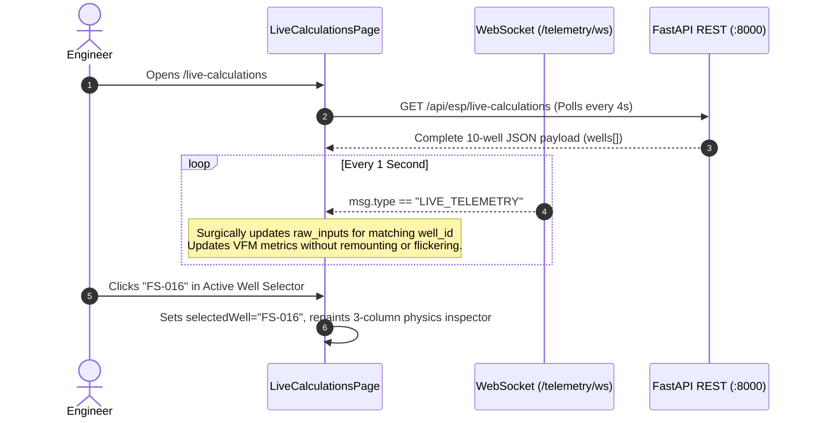

# 🧭 Route Specification: `/live-calculations` — Real-Time Telemetry & Derived Physics Engine
**Application Workspace:** Operations (`WORKSPACES.operations`)  
**File Location:** [`src/routes/live-calculations.tsx`](file:///x:/TAS/v2_ESP/esp-insight-suite/src/routes/live-calculations.tsx)  
**Supporting Component:** [`src/components/esp/FleetKpiFormulasEditor.tsx`](file:///x:/TAS/v2_ESP/esp-insight-suite/src/components/esp/FleetKpiFormulasEditor.tsx)  
**Hooks:** [`src/hooks/useFleetFormulae.ts`](file:///x:/TAS/v2_ESP/esp-insight-suite/src/hooks/useFleetFormulae.ts), [`src/hooks/useEspFleet.ts`](file:///x:/TAS/v2_ESP/esp-insight-suite/src/hooks/useEspFleet.ts)  
**Backend API:** `GET /api/esp/live-calculations`, `POST /api/esp/formulae/save-to-disk`  
**Streaming Protocol:** WebSocket (`LIVE_TELEMETRY` packets + VFM JSON updates)  

***

## 1. Route Metadata & Header

### Route Definition
* **Route Path:** `/live-calculations`
* **Page Title:** `Live Real-Time Telemetry & Derived Physics Calculations — ADVAIT ESP-PMM`
* **Meta Description:** `Real-time 1-second telemetry calculations, Virtual Flow Metering (VFM), higher-order physics, and ML event tagging for all 10 active field wells.`

### Header Section (`PageHeader`)
* **Title:** `Live Calculations & Physics Engine`
* **Description:** `Real-time edge telemetry, virtual flow metering, and physics calculations streaming across active field assets.`
* **Meta Pills & System Badges:**
  1. **Online Assets Badge (`StatusPill tone="normal"`):** Displays `{online_wells} Online / {total_wells} Fleet` with a pulsing green dot.
  2. **Streaming Cadence Badge:** `1s OPC-UA Cadence` indicating sub-second streaming from Java Gateway.
  3. **Flagged Event Counter:** Shows `{anomalyCount} Flagged Events` (Amber if $>0$, Muted if nominal).
  4. **Manual Sync Action Button:** `<button onClick={fetchLiveCalculations}>` with spinning `RefreshCw` icon labeled `Sync 1s`.

### Navigation Tabs (`activeTab`)
Positioned below the header:
* **`Well Physics & VFM`** (`single-well`, default): Deep 3-tier physics, virtual flow metering, and sensor inputs per well.
* **`Fleet KPI Formulas`** (`fleet-kpis`): Live interactive equation editor allowing petroleum engineers to inspect and modify mathematical expressions for fleet KPIs.

***

## 2. Component 1: Ribbon KPI Banner (Fleet Rollup)

Renders across the top in a 4-card responsive grid:

| # | Tile Title | Display Value | Icon | Context & Engineering Tooltip |
|---|---|---|:---:|---|
| **1** | **Online Field Assets** | `{online_wells} / {total_wells}` | `Database` | Total active production wells communicating over OPC-UA (`Mapped to Java OPC Gateway`). |
| **2** | **Total VFM Gross Rate** | `{totalGrossLiquid} BPD` | `Activity` | Sum of virtual flow metered gross liquid across all online assets. Stamped with `Thermodynamic Proof Engine` badge. |
| **3** | **Net Field Oil Output** | `{totalNetOil} BOPD` | `Flame` | Total estimated net oil production rollup based on dynamic well-test water cuts. |
| **4** | **Tagged Field Events** | `{anomalyCount} Anomalies` | `AlertTriangle` | Count of wells deviating from baseline or experiencing trips, powered by the 14-fault ML classifier. |

***

## 3. Component 2: Active Well Selector Ribbon

Horizontal pill bar allowing one-click switching across all 10 active field wells:
* **Asset Pills:** `FS-004`, `FS-006`, `FS-013`, `FS-016`, `FS-017`, `FS-023`, `FS-040`, `FS-047`, `FNW-001`, `FWS-001`.
* **Dynamic Status Dots:**
  * **Emerald (`bg-emerald-500`):** Machine running online in nominal steady-state.
  * **Amber (`bg-amber-400`):** Active anomaly detected by ML classifier or physics breach.
  * **Rose (`bg-rose-500`):** VFD Trip / emergency shut-in ($0.0\text{ Hz}$).
  * **Zinc (`bg-zinc-500`):** Offline / zero communications.
* **Selection State:** Active well is highlighted with primary border, background tint, and elevation shadow.

***

## 4. Component 3: 3-Tier Granular Well Physics Inspector

When an active well is selected, the view renders a **3-Column Grid** detailing raw sensors, thermodynamic models, and higher-order ML classifications:

### Column 1: 14 Standard OPC-UA Inputs (`raw_inputs`)
* **Subtitle:** `Raw SCADA telemetry posted by Java OPC Gateway for {well_id}`
* **Header Action Pill:** `<StatusPill tone="muted">{vsd_status}</StatusPill>` (`RUNNING`, `TRIPPED`, `READY`).
* **14 Tabulated Channels:**
  1. *Intake Pressure (PIP):* `intake_pressure_psi` (PSI)
  2. *Discharge Pressure (PDP):* `discharge_pressure_psi` (PSI)
  3. *Wellhead Pressure (WHP):* `whp_psi` (PSI)
  4. *VFD Operating Frequency:* `frequency_hz` (Hz)
  5. *Motor Current:* `motor_current_a` (A)
  6. *Motor Voltage:* `motor_voltage_v` (V)
  7. *Motor Winding Temp:* `motor_temperature_c` (°C)
  8. *Vibration Level:* `vibration_g` (g)
  9. *Surface Flow Rate:* `flow_rate_bpd` (BPD)
  10. *Choke Valve Opening:* `choke_size_pct` (%)
  11. *Water Cut:* `water_cut_pct` (%)
  12. *Gas Flow Rate:* `gas_flow_mscfd` (MSCFD)
  13. *VSD Operating Status:* String code
  14. *Casing Annulus Pressure:* `casing_pressure_psi` (PSI)

***

### Column 2: Tier 2 Derived & VFM Metrics (`derived_vfm`)
* **Subtitle:** `Physics-based Virtual Flow Metering & Thermodynamic Balance`
* **Header Action Pill:** Energy balance status (`HENCE PROVED`, `VERIFIED`, `ENERGY CONSTRAINED`).
* **10 Solved Parameters:**
  1. *Pump Differential ($\Delta P$):* $\text{PDP} - \text{PIP}$ (PSI).
  2. *Total Dynamic Head (TDH):* Fluid lift generated in feet of liquid (`ft`).
  3. *Head Per Stage:* $\frac{\text{TDH}}{\text{Stage Count}}$ (`ft/stg`).
  4. *VFM Gross Liquid Rate:* Solved volumetric gross liquid in `BPD`.
  5. *VFM Net Oil Rate:* Calculated oil production in `BOPD`.
  6. *VFM Net Water Rate:* Produced brine rate in `BWPD`.
  7. *VFM Calculated Water Cut:* Emulsion percentage (`%`).
  8. *Energy Balance Variance:* First law thermodynamic power error percentage (`%`).
  9. *Hydraulic Shaft Work:* Mechanical energy absorbed by fluid ($\text{BHP}_{\text{hydraulic}}$ in HP).
  10. *Electrical Shaft Work:* Wire-to-water motor shaft power output ($\text{BHP}_{\text{electrical}}$ in HP).

***

### Column 3: Tier 3 Physics & Event Classifier (`high_order_derived` + `event_tagging`)
* **Subtitle:** `Higher-order indicators & live ML fault classification`
* **Card A — Higher-Order Physics Indicators:**
  * *Pressure Ratio (PDP/PIP):* Compression ratio across pump stages.
  * *Hydraulic Power Output:* Total fluid work expressed in kilowatts (`kW`).
  * *Motor Thermal Lift:* Motor temperature rise over intake fluid ($\Delta T$ in °C).
  * *Motor Slip:* Induction rotor slip percentage (`%`).
  * *Vibration Trend:* Mechanical stability indicator (`STABLE`, `ELEVATED`, `SPIKE`).
* **Card B — Tagged ML Event Classifier:**
  * *Header Pill:* Confidence percentage (e.g. `98.4% Conf`).
  * *Baseline State:* `NORMAL` (Green) or `ANOMALY` (Amber).
  * *Tagged Classification:* Diagnosed fault mode (e.g. `Downthrust Exposure`, `Gas Interference & Lock`, `Underload Pump-Off`).
  * *Severity Level:* `CRITICAL`, `WARNING`, `WATCH`, `NORMAL`.
  * *Event Description Box:* Detailed engineering explanation of the physical deviation.

***

## 5. Tab 2: Fleet KPI Formulas Editor (`FleetKpiFormulasEditor`)

* **Purpose:** Provides complete transparent governance over mathematical formulas used across the platform.
* **Capabilities:**
  * Allows authorized engineers to view and modify formula strings (e.g. Availability %, Fleet Deferment BOPD, Weighted Health Index).
  * Syntax validation against standard SCADA symbol dictionaries.
  * **Save to Disk Action:** Serializes governed formulas to `master-formulae.json` on backend disk.
  * **Reset to Default Action:** Restores baseline CCED/OEM standard equations.

***

## 6. Real-Time Data Pipeline & Dual-Sync Protocol

