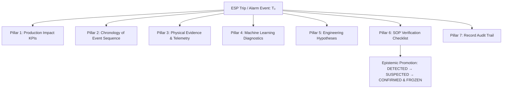

# 🧭 Route Specification: `/events` & `/events/$eventId` — Event Intelligence & Trip Forensics

**Application Workspace:** Operations (`WORKSPACES.operations`)  
**File Locations:**  
* Index Route: [`src/routes/events.index.tsx`](file:///x:/TAS/v2_ESP/esp-insight-suite/src/routes/events.index.tsx)  
* Detail Dynamic Route: [`src/routes/events.$eventId.tsx`](file:///x:/TAS/v2_ESP/esp-insight-suite/src/routes/events.$eventId.tsx)  
* Primary Forensics Component: [`src/components/esp/troubleshooting/EventInvestigationWorkspace.tsx`](file:///x:/TAS/v2_ESP/esp-insight-suite/src/components/esp/troubleshooting/EventInvestigationWorkspace.tsx)  
* Live Rollup Component: [`src/components/esp/troubleshooting/LiveStateStrip.tsx`](file:///x:/TAS/v2_ESP/esp-insight-suite/src/components/esp/troubleshooting/LiveStateStrip.tsx)  
* Hooks & APIs: [`src/hooks/useEspFleet.ts`](file:///x:/TAS/v2_ESP/esp-insight-suite/src/hooks/useEspFleet.ts), [`src/services/espApi.ts`](file:///x:/TAS/v2_ESP/esp-insight-suite/src/services/espApi.ts)  
* Backend Endpoints: `GET /api/v1/incidents`, `POST /api/v1/incidents/{incident_id}/resolve`, `GET /api/v1/events`, `POST /api/v1/investigations/from-event/{event_id}`, `PATCH /api/v1/investigations/{record_id}`  

***

## 1. Route Metadata & Header Architecture

### Route Definitions
* **Index Path:** `/events` or `/events/`
  * **Page Title:** `Event & Incident Intelligence — Real-Time Alarm, Trip & Lifecycle Surveillance | ADVAIT ESP-PMM`
  * **Meta Description:** `Fleet-wide and single-well ESP event intelligence, live incident lifecycle tracking with active duration counters, trip forensics, and standard operating procedures.`
* **Detail Path:** `/events/$eventId`
  * **Page Title:** `Event Forensics {eventId} — ADVAIT ESP-PMM`
  * **Meta Description:** `Forensic investigation and 7-pillar analysis record for ESP event {eventId}`

### Header Section (`PageHeader`)
* **Title:** `Event & Incident Intelligence`
* **Description:** `Unified SCADA Incident Lifecycle & Event Intelligence — Deduplicated active incident tracking with live duration, automated trip forensics, and standard operating procedures.`
* **Meta Indicators:**
  1. **Active Incidents Pill (`StatusPill`):** Displays `{activeCount} Active Incident(s)`. Color is `critical` (pulsing red) if active incidents exist, or `normal` (emerald) when all wells are clear.
  2. **Data SSoT Pill:** `PostgreSQL SSoT Active` indicating direct synchronization with relational incident tables.
  3. **Fleet Asset Count Pill:** `{wells.length} Farha South Assets`.

***

## 2. Component 1: Scope Selection & Asset Targeting

Positioned directly below the header in an elevated toolbar panel (`rounded border border-border bg-panel p-2.5`):
* **Scope Toggle Buttons:**
  * **`● Fleet Level` (`scope === "fleet"`, default):** Aggregates incident lifecycles and SCADA transitions across all 10 Farha South ESP assets.
  * **`○ Single Well` (`scope === "single"`):** Filters the entire screen down to a specific target well.
* **Asset Selector Dropdown:**
  * Smoothly fades in (`animate-in fade-in duration-200`) when `Single Well` is active.
  * Lists all Farha South wells extracted from `useEspFleet()` (`FS-004`, `FS-006`, `FS-013`, `FS-016`, `FS-017`, `FS-023`, `FS-040`, `FS-047`, `FNW-001`, `FWS-001`).
  * Selection immediately updates the downstream queries for both incidents and raw audit events.

***

## 3. Component 2: Live State Strip (`LiveStateStrip`)

Mounted prominently above the filter bar, consuming the WebSocket stream and fleet state:
* **Operating State Distribution:**
  * Count of wells currently **RUNNING** (`tone="normal"`).
  * Count of wells currently **STOPPED** or in planned shut-in (`tone="muted"`).
  * Count of wells currently **TRIPPED** (`tone="critical"`).
* **Live Telemetry Connection Heartbeat:**
  * Displays active MQTT / WebSocket connectivity status to the edge broker.
  * Formatted UTC timestamp of the latest received telemetry packet.
* **Active SCADA Alarms Rollup:**
  * Surfaces high-priority drive alarms (e.g., Underload, Overcurrent, High PIP Drawdown, High Vibration).

***

## 4. Component 3: Filter & Mode Navigation Control Bar

A unified filter toolbar allowing dual-view switching and multi-dimensional querying:
* **Primary View Switcher:**
  * **`Incident Lifecycle ({filteredIncidents.length})`:** Features a `Flame` icon and red badge counter. Displays deduplicated incident records tracking open downtime from inception to resolution.
  * **`Raw Audit Log ({filteredEvents.length})`:** Features a `Database` icon. Displays raw per-second/per-packet SCADA state changes and snapshot captures.
* **Full-Text Search Input:**
  * Text filter with `Search` icon matching Well ID, Trip Cause, Scenario / Fault name, and active alarm tags.
* **Manual Refresh Action:**
  * Button with spinning `RefreshCw` icon triggering concurrent `fetchIncidentsData()` and `fetchEvents()`.
* **Secondary Filter Controls:**
  * **Time Range Selector:** Pills for `1h`, `6h`, `24h` (default), `7d`, and `30d`, calculating milliseconds cutoff `TIME_RANGE_MS[timeRange]`.
  * **Incident Status Filter (Visible in Incidents Mode):** Dropdown for `All`, `Active Only`, and `Resolved Only`.
  * **Severity Filter:** Dropdown for `All`, `Critical`, `Warning`, and `Normal`.
  * **Event Type Filter:** Dropdown for `All`, `Trip`, `Alarm`, and `State Change`.

***

## 5. Component 4: SCADA Incident Lifecycle Table (SSoT View)

When `viewMode === "incidents"`, this table displays deduplicated records from PostgreSQL `/api/v1/incidents`:

| Column Header | Data Field | Display Format & UX Logic |
|---|---|---|
| **Status** | `inc.status` | `🔴 ACTIVE` (`StatusPill tone="critical"`) or `✅ RESOLVED` (`StatusPill tone="normal"`). |
| **Well ID** | `inc.well_id` | Monospace bold asset tag (hidden if filtered to Single Well mode). |
| **Operating State** | `inc.operating_state` | Status pill: `RUNNING` (emerald), `STOPPED` (zinc), or `TRIPPED` (red). |
| **Fault / Scenario** | `inc.scenario` | Human-readable fault designation (e.g. `Dry Well / Pump-Off Underload`, `Gas Locking`, `Sand Ingestion`, or `Nominal Steady-State`). |
| **Trip Cause** | `inc.trip_cause` | Monospace red bold trip code directly latch-reported by the VFD (e.g., `UNDERLOAD_PUMP_OFF`, `OVERLOAD_TRIP`). |
| **Active Alarms** | `inc.alarms` | Array of warning badges (`rounded bg-warning/20 text-warning text-[9.5px]`). |
| **Open Since (UTC)**| `inc.started_at` | Formatted UTC timestamp (`YYYY-MM-DD HH:MM:SS`). |
| **Elapsed / Total Duration** | `inc.started_at` & `inc.duration_seconds` | **`LiveIncidentDuration` Component:** • For **ACTIVE** incidents: Live client-side seconds ticker with an animated pulsing radar dot (`animate-ping bg-critical`) displaying real-time accumulated downtime (`Xh Ym Zs`). • For **RESOLVED** incidents: Static total duration in muted monospace. |
| **Actions** | Action Buttons | • **`Forensic →` (`Link to /events/$eventId`):** Deep-links to the full 7-pillar investigation using `inc.opening_event_id`. • **`Close ✓` (`button`):** One-click manual incident resolution calling `resolveIncident(incidentId, "Manual operator resolution via UI")`. |

***

## 6. Component 5: Raw Event Audit Stream Table (Chronological Log)

When `viewMode === "raw_events"`, this table displays the granular packet audit log from `/api/v1/events`:

| Column Header | Data Field | Display Format & UX Logic |
|---|---|---|
| **Timestamp (UTC)** | `ev.timestamp` | Exact per-second UTC timestamp from OPC-UA historian. |
| **Well ID** | `ev.well_id` | Monospace asset tag. |
| **Operating State** | `ev.operating_state` | Status pill reflecting instantaneous drive state. |
| **Scenario / Fault** | `ev.scenario` | Edge classification tag at packet capture moment. |
| **Trip Cause** | `ev.trip_cause` | VFD latch code or `—` if running nominal. |
| **Active Alarms** | `ev.alarms` | Badges listing drive alert flags. |
| **Snapshot Forensic**| `ev.snapshot_status` | Status pill indicating high-resolution pre/post buffer state: • `CAPTURED` (`tone="normal"`): Full $T_{-300s}$ to $T_{+60s}$ buffer preserved. • `PARTIAL` (`tone="warning"`): Incomplete buffer window. • `PRE-CAPTURED` (`tone="info"`): Buffer captured prior to full trip cycle. • `PENDING` (`tone="muted"`): Processing snapshot. |
| **Actions** | Deep Link | Clickable row or `Inspect →` button routing to `/events/$eventId`. |

***

## 7. Component 6: Dedicated 7-Pillar Forensics Workspace (`/events/$eventId`)

Mounted on `/events/$eventId` via [`EventInvestigationWorkspace.tsx`](file:///x:/TAS/v2_ESP/esp-insight-suite/src/components/esp/troubleshooting/EventInvestigationWorkspace.tsx). Features optimistic locking (`version`), actor tracking, and an unauthenticated notice:

### Investigation Header & Control Toolbar
* **Target Identifiers:** Monospace Well ID, Trip Code, Event ID, and UTC timestamp.
* **Epistemic Status Badge:** `DETECTED` (amber), `SUSPECTED` (blue), or `CONFIRMED` (emerald).
* **Record Version & Freeze Indicator:**
  * `v{version}` tag ensuring safe concurrent editing without overwrite conflicts.
  * `🔒 Frozen` badge (when resolved and locked) or `🔓 Active Draft` badge.
* **Markdown Export Button:** `Export Report` button executing `exportInvestigationMarkdown()` to generate an auditable Markdown dossier.
* **Optimistic Locking Conflict Banner:** Renders automatically with a `Refresh Latest State` action if another operator has committed edits concurrently.

***

### The 7 Analytical Investigation Pillars

#### Pillar 1: Production Impact & Financial Loss KPIs
* **Gross Production Deficit Rate:** BPD gross rate lost during outage with Net Oil sub-metric (`summary.flowLossGrossBpd` and `flowLossNetOilBopd`).
* **Daily Revenue Lost:** Calculated at $\$75/\text{bbl}$ benchmark: $\text{Daily Loss} = \text{BOPD} \times \$75$.
* **Downtime Duration:** Live ticking clock (`Xh Ym Zs`) running until the incident is frozen.
* **Cumulative Downtime Loss:** Real-time financial meter: $\text{Loss} = \left(\frac{\text{elapsed seconds}}{86400}\right) \times \text{Daily Revenue Impact}$.

#### Pillar 2: Chronology of Event Sequence
* **Timeline Rail:** Relative timestamps from $T_{-300s}$ through $T_0$ (Trip Moment) to $T_{+60s}$.
* **Node Types:**
  * Blue nodes ($T < 0$): Pre-trip precursors, warnings, and frequency ramps.
  * Critical Red node ($T = 0$): Exact moment VFD latched shutdown.
  * Grey nodes ($T > 0$): Post-trip deceleration, pressure recovery, and SCADA alerts.
* **Data Fields:** Relative seconds, source system (`SCADA`, `VFD`, `PHYSICS_ENGINE`), operational phase, and detailed description.

#### Pillar 3: Physical Evidence & Telemetry Excursions
* **Threshold Excursion Badges:** Highlights sensor breaches (e.g. `PIP Excursion: Measured 65 PSI, Limit 150 PSI`).
* **Event-Moment Sensor Grid (6 Parameters):**
  * Frequency (`Hz`), Motor Current (`A`), Intake Pressure (`PIP PSI`), Discharge Pressure (`PDP PSI`), Motor Temperature (`°C`), Vibration (`g`).
* **Synchronized High-Resolution Trend Chart:**
  * Interactive multi-parameter Recharts line plot across the trip window displaying Current (Amps), Vibration (g), and Frequency (Hz) over time.

#### Pillar 4: Machine Learning Diagnostics (Pre-Trip Reality)
* **Pre-Trip Detected Fault:** Primary classification produced by the ML model prior to the physical trip.
* **Anomaly Score & Lookback Window:** Quantitative statistical distance from nominal and evaluation timing before trip.
* **8-Class Probability Spectrum:**
  * Horizontal visual probability bars for the 8 trained classes: Bearing Degradation, Blocked Intake, Dry-Well Pump Off, Motor Overload, Normal, Phase Imbalance, Sand Ingestion, Undervoltage.
* **Non-Modelled Notice:** Explicitly lists catalog faults not trained in the active model version (e.g., Gas Lock, Broken Shaft, High Backpressure).
* **SHAP Telemetry Feature Drivers:** Tags indicating parameters that drove the anomaly prediction, stamped with `RISK_UP` (red) or `RISK_DOWN` (green).

#### Pillar 5: Multi-Source Engineering Hypotheses
* **Leading Hypothesis Card:** Displays primary engineering hypothesis, catalog reference, supporting physical evidence, and contradictory evidence.
* **Alternative Hypothesis Card:** Secondary differential diagnosis to prevent confirmation bias.
* **Investigation Copilot Provision Slot:** Dedicated placeholder badge (`AWAITING AGENT TEAM`) designed for autonomous multi-agent root-cause reasoning.

#### Pillar 6: Standard Operating Procedure (SOP) Verification
* **Acting Engineer Selector:** Self-reported operator field with explicit disclaimer: `*Notice: Backend operates in unauthenticated mode; actor identities are self-reported.`
* **Interactive Checklist:** Step-by-step verification steps (e.g., Step 1: Verify surface electrical supply; Step 2: Confirm check valve integrity). Checking a step automatically stamps the operator signature and timestamp.
* **Confirmed Root Cause Formulation:** Free-text engineering entry required before locking the record.
* **Lifecycle State Promotions:**
  * `Promote to SUSPECTED` button.
  * `Confirm & Freeze Record` button (locks version, stamps `resolvedAt`, and freezes downtime cost).

#### Pillar 7: Record Audit Trail
* Monospace audit log displaying timestamp, acting user, action taken (`RECORD_CREATED`, `CHECKLIST_STEP_VERIFIED`, `ROOT_CAUSE_UPDATED`, `RECORD_FROZEN`), and mutation details.
