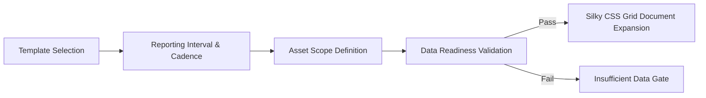

# 🧭 Route Specification: `/reports` — Operational Reports & Governance Hub

**Application Workspace:** Operations (`WORKSPACES.operations`)  
**File Location:** [`src/routes/reports.tsx`](file:///x:/TAS/v2_ESP/esp-insight-suite/src/routes/reports.tsx)  
**Supporting Components:**  
* [`ReportBuilder.tsx`](file:///x:/TAS/v2_ESP/esp-insight-suite/src/components/esp/reports/ReportBuilder.tsx)  
* [`ReportPreview.tsx`](file:///x:/TAS/v2_ESP/esp-insight-suite/src/components/esp/reports/ReportPreview.tsx)  
* [`InsufficientDataView.tsx`](file:///x:/TAS/v2_ESP/esp-insight-suite/src/components/esp/reports/InsufficientDataView.tsx)  
* [`ReportArchive.tsx`](file:///x:/TAS/v2_ESP/esp-insight-suite/src/components/esp/reports/ReportArchive.tsx)  
**Governance & Engine Modules:** [`src/lib/esp/historian.ts`](file:///x:/TAS/v2_ESP/esp-insight-suite/src/lib/esp/historian.ts), [`src/data/esp/reports.ts`](file:///x:/TAS/v2_ESP/esp-insight-suite/src/data/esp/reports.ts)  
**Database Provenance:** PostgreSQL SCADA Historian Replica (`postgresql://esp_apm_db`)  

***

## 1. Route Metadata & Governance Rules

### Route Definition
* **Route Path:** `/reports`
* **Page Title:** `Operational Reports & Governance Hub — ADVAIT ESP-PMM`
* **Meta Description:** `Zero-fabrication operational reporting: Telemetry & Operations Log Report, Well Performance deep-dive, and audited export workflows.`

### Core Engineering Governance Philosophy (Zero-Fabrication)
The Reports Hub implements strict petroleum data governance rules to eliminate AI hallucinations and synthetic data fabrication:
* **Rule 1 (Data Completeness Gate):** Requires $\ge 98.0\%$ valid sensor data packets across the queried window.
* **Rule 2 (Zero-Fabrication Hard Stop):** If sensor telemetry is missing, corrupt, or unverified, the system refuses to generate synthetic estimates and instead routes the user to the `InsufficientDataView` explaining the gap.
* **Rule 3 (Sensor Integrity Flagging):** Gauge drift, missing PIP, or VFD communication interruptions are explicitly flagged in the document header and export metadata.

### Header Section (`PageHeader`)
* **Title:** `Operational Reports & Governance Hub`
* **Description:** `Comprehensive ESP operational reporting: Telemetry & Operations Log Reports and Well Performance diagnostic audits.`
* **Status Pill:** `Historian Connected (UTC)` confirming active read connection to the PostgreSQL replica.

***

## 2. Component 1: Report Builder & Governance Control (`ReportBuilder`)

The configuration bench allows petroleum surveillance engineers to define reporting boundaries across 6 granular controls:

### Granular Form Parameters

| # | Control Name | UI Type | Options / Formats | Validation & Code Rules |
|---|---|---|---|---|
| **1** | **Report Template** | Dropdown | • `Telemetry & Operations Log Report` (`type: "log"`) • `Well Performance Report` (`type: "well_performance"`) | Governed by `REPORT_CONFIGS`. Switching templates resets cadence and defaults to appropriate asset scopes. |
| **2** | **Reporting Period** | Dropdown + Date Range | • `Last 1 hour` • `Last 6 hours` • `Last 24 hours` • `Last 7 days` • `Custom UTC Window` | `computePeriodRange()` calculates exact ISO UTC start and end bounds (`customStartUtc`, `customEndUtc`). |
| **3** | **Logging Cadence** | Dropdown | • Log Report: `raw`, `1m`, `5m`, `15m`, `1h` • Well Performance: `1h`, `4h`, `12h`, `1d` | **Anti-Bloat Guard:** For `well_performance`, if high-frequency cadences (`raw`, `1m`, `5m`) are selected, the system automatically sanitizes the request to `1h`. |
| **4** | **Asset Scope** | Radio / Dropdown | • `All Fields & Clusters` (`scope: "all"`) • `Gathering Center` (`scope: "field"`: GCS-03, GCS-04, GCS-15) • `Individual Well` (`scope: "well"`) | Dropdowns populate Farha South assets (`FS-004`, `FS-006`, etc.) dynamically via `useEspFleet()`. |
| **5** | **Generated By** | Text Input | Author signature tag (Default: `VK (Ops Engineer)`) | Stamped onto the audit header of exported reports. |
| **6** | **Telemetry Condition** | Mode Selector | • `NORMAL` (100% verified) • `PARTIAL` (Flags gauge gap) • `INSUFFICIENT` (Triggers Rule 2 gate) | Used for operational testing and audit trail verification. |

### Generation Trigger (`handleGenerate`)
Clicking **`Generate Report`**:
1. Sanitizes cadence to prevent browser memory exhaustion.
2. Runs `validateDataReadiness()`.
3. Appends a structured audit record into `ReportArchive`.
4. Executes a dual `requestAnimationFrame` to trigger silky cubic-bezier CSS Grid height expansion (`0fr` $\rightarrow$ `1fr`), followed by smooth auto-scrolling to the preview container.

***

## 3. Component 2: Governed Report Document Preview (`ReportPreview`)

Renders a production-grade, print-ready document preview directly inside the browser:

### Document Header & Provenance
* **Corporate Header:** Advait Energy Technologies branding, logo, and ISO metadata.
* **Document Number:** Unique stamped identifier (e.g., `REP-20261014-01`).
* **Security & Classification:** `CONFIDENTIAL — OMAN FIELD OPERATIONS`.
* **Provenance Banner:** Confirms source as `scada_historian_replica (postgresql://esp_apm_db)` with query execution timestamp in UTC.

### Executive KPI Summary Strip
Calculated across the selected operational window:
* **Gross Production Volume:** Total liquid barrels produced (`bbl`).
* **Net Oil Output:** Total hydrocarbon barrels accounting for dynamic water cut (`stb`).
* **Cumulative Energy Consumption:** Electrical power consumed downhole (`kWh`).
* **Operational Uptime Ratio:** Percentage of time the VFD ran nominal without trip events (`%`).

### Tabular Telemetry & Diagnostic Sections
* **For Telemetry Log Report:** Chronological table displaying Frequency (Hz), Current (A), PIP (psi), PDP (psi), Motor Temp (°C), Vibration (g), and Flow Rate (BPD) at the requested cadence.
* **For Well Performance Report:** Multi-zone breakdown covering Pump Efficiency, Total Dynamic Head (TDH), Operating Point vs Best Efficiency Point (BEP), and Motor Thermal Headroom.
* **Excursion Highlighting:** Readings breaching field warning or critical trip limits are color-coded in amber and red.

### Export Action Bar
* **`Download Microsoft Excel (.xlsx)`:** Generates a multi-sheet spreadsheet with Advait corporate styling, formatted number cells, and formula metadata.
* **`Download CSV Log (.csv)`:** Exports raw, comma-delimited time series adhering to POSIX standards for ingest into external reservoir simulators (e.g. Eclipse, Petrel).
* **`Close Preview`:** Smoothly collapses the preview panel back to the builder form.

***

## 4. Component 3: Insufficient Data Gate (`InsufficientDataView`)

Triggered whenever telemetry fails Rule 1 or Rule 2 readiness criteria:

### UI/UX Visual Elements
* **Alert Banner (`tone="critical"`):** Prominently displays `INSUFFICIENT TELEMETRY DATA — GENERATION HALTED`.
* **Reasoning Breakdown:** Lists exact failed telemetry checks, such as:
  * `Downhole gauge (PIP/PDP) missing data for 45 minutes.`
  * `Telemetry packet completeness 84.2% (minimum threshold 98.0% required).`
  * `Edge gateway heartbeat timeout exceeded.`
* **Zero-Hallucination Disclaimer:** Reassures operators that Advait ESP-PMM never generates estimated or fictitious numbers in audited reports.
* **Remediation Action:** Provides an `Inspect Gauge Health` action and a `Retry Telemetry Validation` button.

***

## 5. Component 4: Report Archive Registry (`ReportArchive`)

A persistent table of historical reports generated during the surveillance session:

| Column Header | Field Name | Description |
|---|---|---|
| **Report ID** | `item.id` | Monospace identifier (e.g. `REP-20261014-01`). |
| **Generated Date** | `item.dateGeneratedUtc` | Exact UTC timestamp of report compilation. |
| **Template** | `item.reportTitle` | Report name and target well/field. |
| **Reporting Period** | `item.periodText` | Start and end UTC window. |
| **Scope** | `item.scopeText` | Fleet, cluster, or specific well identifier. |
| **Author** | `item.generatedBy` | Name or badge of the surveillance engineer. |
| **Quality Status** | `item.status` | Status pill: `Ready` (emerald), `Partial data` (amber), or `Insufficient data` (red). |
| **Data Quality Summary**| `item.dataQualitySummary` | One-line audit explanation of sensor verification. |
| **Actions** | Action Buttons | • **`Re-Run`:** Re-loads parameters into builder and recompiles. • **`Delete`:** Removes entry from local session archive. |
